# Agentic Predictive Maintenance — C-MAPSS Turbofan RUL Estimation

This repository contains an end-to-end **Agentic Predictive Maintenance** system built for a university deep learning course. The project analyzes NASA C-MAPSS turbofan engine run-to-failure telemetry to estimate engine **Remaining Useful Life (RUL)**.

---

## 1. Project Directory Structure

```text
predictive_maintenance/
├── app/
│   └── app.py                      <- Phase 8 & 9: Streamlit Operations Dashboard (7 Pages, Live Demo)
├── config/
│   └── sim_params.yaml             <- Phase 5 fleet simulation parameters & costs
├── data/
│   ├── raw/
│   │   ├── train_FD001.txt         <- 100 run-to-failure engines (20,631 cycles)
│   │   ├── test_FD001.txt          <- 100 test engines truncated before failure (13,096 cycles)
│   │   └── RUL_FD001.txt           <- True RUL values for test engines at last observed cycle
│   └── processed/
│       ├── X_train.npy             <- (17731, 30, 14) float32 sliding-window train sequences
│       ├── y_train.npy             <- (17731,) float32 capped RUL targets
│       ├── X_test.npy              <- (100, 30, 14) float32 final-window evaluation sequences
│       ├── y_test.npy              <- (100,) float32 raw true RUL ground truth
│       ├── y_test_capped.npy       <- (100,) float32 capped true RUL (cap=125)
│       └── test_unit_order.npy     <- (100,) int engine unit IDs (1..100)
├── notebooks/
│   ├── 01_eda.ipynb                <- Phase 1: Exploratory Data Analysis Notebook
│   ├── run_eda.py                  <- Phase 1: Automated EDA script
│   ├── 02_preprocessing_check.ipynb <- Phase 2: Preprocessing pipeline verification Notebook
│   ├── run_preprocessing.py        <- Phase 2: Automated preprocessing execution script
│   ├── 03_model_training.ipynb     <- Phase 3: LSTM Model Training Notebook
│   ├── run_training.py             <- Phase 3: Automated Model Training & Tuning
│   ├── 04_uncertainty_quantification.ipynb <- Phase 4: Uncertainty Quantification Notebook
│   ├── run_uncertainty.py          <- Phase 4: MC-Dropout & Binned Residual Calibration
│   ├── run_phase4c.py              <- Phase 4c: 5-Fold CV & L=20 vs L=30 Context Study
│   └── run_phase5.py               <- Phase 5: Simulator Execution & Baseline Benchmark
├── src/
│   ├── __init__.py                 <- Package exports
│   ├── data_loader.py              <- Data ingestion utility (load_cmapss)
│   ├── preprocessing.py            <- Feature dropping, RUL capping, scaling, sequence generator
│   ├── model.py                    <- PyTorch LSTM sequence regressor
│   ├── train.py                    <- Training loop, target normalization, NASA scoring metric
│   ├── uncertainty.py              <- Binned residual intervals & MC-Dropout calibration
│   ├── simulator.py                <- Discrete-event fleet maintenance simulator
│   ├── policies.py                 <- Baseline maintenance policies & Diagnostic Oracle
│   ├── agents.py                   <- 4 Collaborative Maintenance Scheduling Agents (live & replay)
│   ├── agent_tools.py              <- LangChain @tool wrappers (closure session, zero leakage)
│   └── agentic_graph.py            <- LangGraph StateGraph multi-agent orchestrator & guardrails
├── tests/
│   ├── test_simulator.py           <- Pytest suite verifying 11 simulator sanity checks & audits
│   ├── test_agents.py              <- Pytest suite verifying 6 agent information & invariant checks
│   ├── test_dashboard.py           <- Pytest suite verifying dashboard data schemas, live demo & AppTest
│   ├── test_agent_tools.py         <- Pytest suite verifying 5 LangChain tool wrapper invariants
│   └── test_agentic_graph.py       <- Pytest suite verifying 6 LangGraph agentic orchestration tests
├── outputs/
│   ├── best_lstm_model.pt          <- Trained PyTorch LSTM champion checkpoint
│   ├── tuning_results.csv          <- Hyperparameter sweep logs (8 configurations)
│   ├── scaler.pkl                  <- Fitted MinMaxScaler object for inference
│   ├── uncertainty_calibration.json <- Fitted MC-Dropout scaling factor (k=7.2327)
│   ├── residual_interval_calibration.json <- 5-bin empirical residual quantiles
│   ├── oof_predictions_L20.csv     <- 5-Fold cross-validated OOF predictions (L=20)
│   ├── oof_predictions_L30.csv     <- 5-Fold cross-validated OOF predictions (L=30)
│   ├── results_final.json          <- Single canonical source of truth (20 seeds, A/B/C, exact costs)
│   ├── phase7_results.json         <- Experiment 6 sensitivity sweep results
│   ├── decision_log.jsonl          <- Transparent agent scheduling audit trail
│   ├── agent_graph.md              <- Mermaid graph architecture specification
│   ├── agentic_eval.json           <- 31-engine comparative evaluation benchmark
│   ├── eda_plots/                  <- High-resolution (300 DPI) visualizations (01..24)
│   └── dashboard_screenshots/      <- High-resolution screenshots of the 8 app pages
├── demo.py                         <- Live CLI demonstration script (rule-based & LangGraph agentic)
├── scratch/
│   ├── eval_agentic.py             <- 31-engine evaluation script (E-017 + Units 1..30)
│   └── capture_screenshots.py      <- Headless Chrome CDP screenshot capture utility
├── requirements.txt                <- Project dependencies (pinned)
├── PROJECT_STATUS.md               <- Project audit and status report
└── README.md                       <- Comprehensive project documentation and findings
```

---

## 2. Dataset Overview: NASA C-MAPSS (FD001)

### What is FD001?
The **Commercial Modular Aero-Propulsion System Simulation (C-MAPSS)** dataset provided by NASA Ames Prognostics Center of Excellence simulates thermodynamic gas-turbine engine degradation under operational cycles.

Subset **FD001** is configured with:
* **Operating Conditions:** 1 (Sea Level operation)
* **Fault Mode:** 1 (High-Pressure Compressor / HPC degradation)
* **Training Engines:** 100 engines monitored from pristine state until catastrophic failure (20,631 total cycles)
* **Test Engines:** 100 engines monitored until an arbitrary point before failure (13,096 total cycles)
* **Ground Truth:** `RUL_FD001.txt` provides the exact Remaining Useful Life for each test engine at the end of its observed sequence.

### Why FD001 was Chosen
1. **Isolated Degradation Physics:** Because FD001 features only a single operating condition, sensor variations reflect true physical component wear rather than operating regime changes (e.g., altitude or Mach number shifts).
2. **Ideal Benchmark for Deep Learning:** It provides a clean, standardized foundation to establish baseline temporal models (e.g., LSTM, GRU, Transformers) before scaling up to multi-condition datasets (FD002/FD004).

### Schema & Column Ordering
The space-delimited text files contain 26 columns without headers:
1. `unit_number`: Engine identifier ($1 \dots 100$)
2. `time_in_cycles`: Current flight/operational cycle ($1 \dots \text{max\_cycle}$)
3. `operational_setting_1`: Altitude / throttle setting resolver
4. `operational_setting_2`: Mach number resolver
5. `operational_setting_3`: TRA resolver (constant at 100.0)
6. `sensor_measurement_1` through `sensor_measurement_21`: 21 physical sensor measurements (temperatures, pressures, fan speeds, bleed flows, coolant ratios).

---

## 3. Phase 1: Key Findings from EDA

### A. Engine Life-Cycle Distribution
* **Total Engines Analyzed:** 100 (Training Set)
* **Minimum Lifetime:** 128 cycles (Engine Unit 39)
* **Maximum Lifetime:** 362 cycles (Engine Unit 69)
* **Mean Lifetime:** $206.31 \pm 46.34$ cycles
* **Median Lifetime:** 199.0 cycles ($IQR = [177.0, 229.2]$ cycles)
* **Key Takeaway:** Engine lifespans vary by nearly $3\times$ despite identical initial conditions and single-fault dynamics, illustrating stochastic wear rates.

### B. Low-Information / Near-Constant Features
Through empirical variance analysis across all 20,631 records, 10 features were identified as uninformative ($\sigma^2 < 10^{-3}$):
* **Constant Sensors ($\sigma^2 = 0$):** `sensor_measurement_1`, `5`, `10`, `16`, `18`, `19`
* **Near-Constant Sensor:** `sensor_measurement_6` ($\sigma^2 = 1.93 \times 10^{-6}$)
* **Operational Settings:** `operational_setting_3` (constant 100.0), `operational_setting_1` ($\sigma^2 = 4.78 \times 10^{-6}$), `operational_setting_2` ($\sigma^2 = 8.59 \times 10^{-8}$)

### C. Strongest RUL Predictors & Degradation Trends
14 sensors demonstrate prominent, monotonic degradation profiles:
* **Increasing toward failure ($r < -0.55$, Late Shift $> +2.0\sigma$):** `sensor_measurement_11` ($r = -0.696$), `4` ($r = -0.679$), `15` ($r = -0.643$), `2` ($r = -0.606$), `17` ($r = -0.606$), `3` ($r = -0.585$), `8` ($r = -0.564$), `13` ($r = -0.563$).
* **Decreasing toward failure ($r > +0.60$, Late Shift $< -2.0\sigma$):** `sensor_measurement_12` ($r = +0.672$), `7` ($r = +0.657$), `21` ($r = +0.636$), `20` ($r = +0.629$).

---

## 4. Phase 2: Preprocessing Pipeline

The preprocessing pipeline prepares the raw telemetry data into temporal sequence matrices ready for deep learning training.

### A. Feature Pruning (Final Feature Count = 14)
The 10 uninformative columns identified in Phase 1 are dropped. The resulting dataset retains **14 informative sensor features**:
$$\text{Sensors: } [2, 3, 4, 7, 8, 9, 11, 12, 13, 14, 15, 17, 20, 21]$$

### B. Piecewise-Linear RUL Capping ($RUL_{\text{cap}} = 125$)
In prognostic modeling of turbofan engines, physical wear is negligible during early operating cycles. The engine operates in a stable "healthy" state until initial micro-faults propagate into exponential degradation.

* **Formula:** $\text{RUL}_{\text{capped}}(t) = \min(\text{max\_cycles} - t, 125)$
* **Why Cap at 125?**
  1. *Prevents Negative Transfer:* Forcing a network to distinguish between RUL=300 vs RUL=250 when sensor readings are identical induces loss penalty on healthy noise.
  2. *Standard Benchmark Alignment:* Literature on C-MAPSS consistently adopts $RUL_{\text{max}} = 125$ to $130$ cycles as the empirical threshold where degradation traces separate from nominal baselines.
  3. *Training Impact:* In the FD001 training set, 8,031 out of 20,631 cycles ($38.9\%$) are capped at 125.

### C. MinMax Scaling (Zero-Leakage)
* `MinMaxScaler(feature_range=(0, 1))` is fitted **strictly on training sensor features**.
* Both training and test features are transformed using the fitted scaler parameters.
* The fitted scaler is persisted to `outputs/scaler.pkl` using `joblib` for inference reuse.

### D. Sliding Window Sequence Generation ($\text{sequence\_length} = 30$)
* **Sliding Window:** For each engine, a temporal window of $30$ consecutive cycles slides across the time series:
  - Input $X_i \in \mathbb{R}^{30 \times 14}$ represents 30 consecutive readings across the 14 sensors.
  - Target $y_i \in \mathbb{R}$ is the $RUL_{\text{capped}}$ value at the last cycle of that window.
* **Why Sequence Length = 30?**
  - In Phase 1 EDA, minimum engine lifetime in the training set was **128 cycles** (Unit 39), and in the test set was **31 cycles** (Unit 1).
  - A window of 30 cycles is sufficiently long to capture trend acceleration while ensuring that **0 training engines and 0 test engines** require artificial padding in FD001.
  - If applied to shorter sequences ($<30$ cycles), the pipeline automatically applies repeat left-padding.
* **Test Set Evaluation Windows:**
  - For the test set, exactly **ONE** sequence is extracted per engine: the last 30 observed cycles before the sequence ends.

### E. Final Processed Dataset Dimensions

| Dataset Array | Shape | Data Type | Description |
| :--- | :--- | :--- | :--- |
| **`X_train.npy`** | `(17731, 30, 14)` | `float32` | 17,731 temporal sequences across 100 training engines |
| **`y_train.npy`** | `(17731,)` | `float32` | Capped RUL targets ($[0, 125]$ cycles) |
| **`X_test.npy`** | `(100, 30, 14)` | `float32` | 100 final-window evaluation sequences |
| **`y_test.npy`** | `(100,)` | `float32` | Ground truth test RUL from `RUL_FD001.txt` |
| **`y_test_capped.npy`** | `(100,)` | `float32` | Ground truth test RUL capped at 125 |
| **`test_unit_order.npy`** | `(100,)` | `int64` | Ordered unit IDs ($1 \dots 100$) |

---

---

## 5. Phase 3: LSTM Model Training & Evaluation

Phase 3 builds a deep recurrent sequence model using PyTorch to predict turbofan Remaining Useful Life (RUL), executes an 8-configuration hyperparameter sweep, and evaluates the champion model on held-out test engines.

### A. Engine-Level Train / Validation Split (Zero Data Leakage)
In time-series predictive maintenance, overlapping sliding-window sequences from the same physical machine share identical operating histories. A naive random sequence split causes severe information leakage and artificially optimistic validation scores.

To prevent leakage, the 100 training engines were partitioned at the **engine level** using a fixed random seed (`seed=42`):
* **Training Partition (80 Engines):** 14,459 sliding-window sequences ($X_{\text{train}}: [14459, 30, 14]$, $y_{\text{train}}: [14459]$).
* **Validation Partition (20 Engines):** 3,272 sliding-window sequences ($X_{\text{val}}: [3272, 30, 14]$, $y_{\text{val}}: [3272]$).
* **Total Sequence Integrity:** $14,459 + 3,272 = 17,731$ sequences ($100.0\%$ conservation, zero overlap).

```
100 Training Engines
├── 80 Engines (Train Split)      ──> 14,459 Sequences (30 × 14)
└── 20 Engines (Validation Split) ──>  3,272 Sequences (30 × 14)
```

### B. PyTorch LSTM Architecture
The `LSTMRegressor` in [`src/model.py`](src/model.py) implements the required Phase 3/4 neural pipeline:
1. **Recurrent Core:** Stacked PyTorch `nn.LSTM` (2 layers, configurable `hidden_size`).
2. **Temporal Aggregation:** Extracts the hidden state from the final sequence cycle ($t=30$).
3. **Explicit Post-LSTM Dropout:** Standard `nn.Dropout(p=dropout_rate)` placed after temporal feature extraction.
   * *Phase 4 Extensibility:* Includes `model.enable_mc_dropout()` and `model.disable_mc_dropout()` methods so stochastic Monte Carlo uncertainty sampling can be enabled during inference without model rewriting.
4. **Linear Head:** Maps `hidden_size` $\rightarrow 1$ to predict scalar RUL.

```
Input Sequence [Batch, 30, 14]
          │
          ▼
   2-Layer LSTM
  (hidden_size: 32 / 64)
          │
          ▼
  Final Hidden State [Batch, hidden_size]
          │
          ▼
    Post-LSTM Dropout
  (rate: 0.2 / 0.3, MC-ready)
          │
          ▼
  Dense Linear Layer [hidden_size -> 1]
          │
          ▼
    Predicted RUL
```

### C. Hyperparameter Tuning Grid (8 Configurations)
An 8-run hyperparameter grid was executed using target normalization ($y / 125.0$), the Adam optimizer, MSE loss, and early stopping tracked strictly on **unscaled Validation MAE** ($\text{patience}=8$, maximum 60 epochs).

| Config ID | Hidden Units | Dropout Rate | Learning Rate | Val MAE (Cycles) | Val RMSE (Cycles) | Val NASA Score | Best Epoch / Total | Near Max Flag ($\ge 57$) |
| :---: | :---: | :---: | :---: | :---: | :---: | :---: | :---: | :---: |
| **#5 (Winner)** | **64** | **0.2** | **0.0010** | **8.7577** | **12.8300** | **10,407.40** | **35 / 43** | False |
| #1 | 32 | 0.2 | 0.0010 | 8.8951 | 12.8328 | 10,107.40 | 25 / 33 | False |
| #8 | 64 | 0.3 | 0.0005 | 8.9019 | 12.9555 | 10,913.53 | 35 / 43 | False |
| #6 | 64 | 0.2 | 0.0005 | 8.9715 | 13.0672 | 11,228.39 | 35 / 43 | False |
| #7 | 64 | 0.3 | 0.0010 | 8.9729 | 12.9526 | 10,653.80 | 35 / 43 | False |
| #3 | 32 | 0.3 | 0.0010 | 9.0749 | 12.9529 | 10,300.03 | 25 / 33 | False |
| #4 | 32 | 0.3 | 0.0005 | 9.4151 | 13.6035 | 12,043.31 | 21 / 29 | False |
| #2 | 32 | 0.2 | 0.0005 | 9.4732 | 13.6603 | 12,345.38 | 21 / 29 | False |

*Full tuning logs saved to [`outputs/tuning_results.csv`](outputs/tuning_results.csv).*

### D. Model Selection Rationale
* **Winning Model:** **Configuration #5** (`hidden_size=64`, `dropout=0.2`, `learning_rate=0.0010`).
* **Selection Criterion:** Selected strictly based on the lowest **Validation MAE** (**8.7577 cycles**). Held-out test set metrics were strictly excluded from model selection and early stopping.
* **Convergence Dynamics:** Best validation MAE achieved at **Epoch 35**; early stopping terminated training gracefully at Epoch 43 (no configs hit near-max flags).
* **Model Checkpoint:** Saved to [`outputs/best_lstm_model.pt`](outputs/best_lstm_model.pt) with architecture metadata and `target_scale=125.0` for downstream Phase 4 uncertainty quantification.

### E. Held-Out Test Set Evaluation (100 Test Engines)
The champion model (Config #5) was evaluated **once** against the official 100 test engines in `RUL_FD001.txt`:

| Evaluation Metric | Capped Target ($RUL \le 125$) | Raw True Target ($RUL$) |
| :--- | :---: | :---: |
| **Mean Absolute Error (MAE)** | **10.200 cycles** | **11.270 cycles** |
| **Root Mean Squared Error (RMSE)** | **13.898 cycles** | **15.382 cycles** |
| **NASA Asymmetric Scoring Function** | **307.87** | **364.81** |

*Note: Prediction range across the 100 test engines spans from **4.05 cycles** (imminent failure) to **125.02 cycles** (healthy engines).*

#### NASA Asymmetric Scoring Function
The official C-MAPSS scoring metric penalizes overestimating remaining life (late maintenance, which risks engine failure) exponentially more than underestimating (early maintenance):
$$s_i = \begin{cases} e^{-d_i / 13} - 1 & \text{if } d_i < 0 \text{ (early prediction)} \\ e^{d_i / 10} - 1 & \text{if } d_i \ge 0 \text{ (late prediction)} \end{cases}, \quad \text{Score} = \sum_{i=1}^{100} s_i$$
where $d_i = \hat{y}_i - y_i$.

### F. Visualizations

#### 1. Predicted vs. Actual RUL on Held-Out Test Set
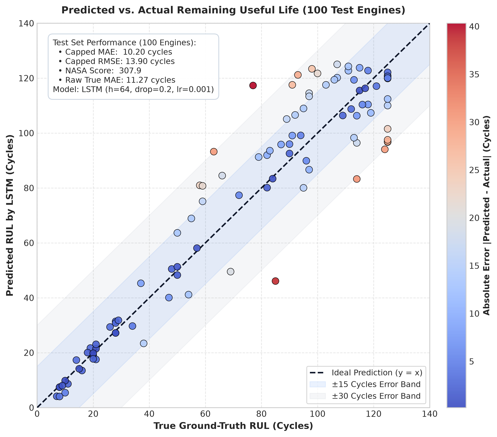
*Scatter plot showing Config #5 predictions against ground truth RUL across all 100 test engines. Predictions tightly track the ideal $y = x$ line, especially for engines near failure ($RUL < 40$).*

#### 2. Training and Validation Loss Curves
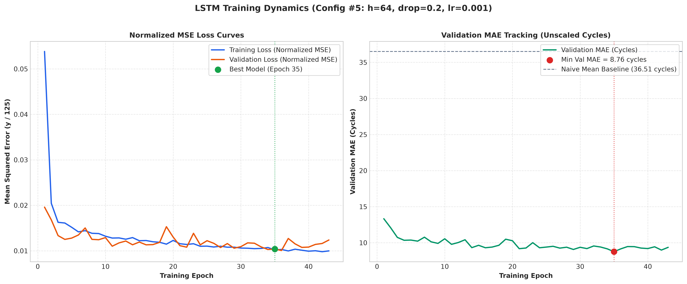
*Normalized MSE loss and unscaled Validation MAE curves showing smooth convergence and optimal early stopping checkpoint at Epoch 35.*

### G. Documented Lesson Learned: Target Normalization & Gradient Balance
> [!IMPORTANT]
> **Root Cause Analysis (Target Scale Disparity):**
> When input features $X$ are MinMax-scaled into $[0, 1]$ while regression targets $y \in [0, 125]$ remain unscaled, the MSE loss gradients with respect to output predictions ($\frac{\partial \mathcal{L}}{\partial \hat{y}} = 2(\hat{y} - y) \approx -163$) are orders of magnitude larger than recurrent input activations.
> 
> As a consequence:
> 1. The linear head bias $b$ rapidly absorbs the dataset mean ($\bar{y}_{\text{train}} \approx 81.48$).
> 2. Once the bias predicts the mean, MSE loss drops to the target variance ($\approx 1714 \approx 41.4^2$), where loss plateaus.
> 3. Because LSTM hidden activations are bounded ($\tanh(h) \in [-1, 1]$), the recurrent layers produce minuscule gradient updates relative to the loss magnitude, trapping the network in a bias-dominated collapse where all predictions equal $\sim 76\text{--}81$ cycles (Validation MAE $\sim 36.6$ cycles).
> 
> **Architectural Fix:**
> Normalizing targets during training to $[0, 1]$ via $y / 125.0$ restores equal gradient magnitude across all recurrent and dense layers. Un-normalizing predictions ($\hat{y} \times 125.0$) via a unified helper (`scale_target` / `unscale_target`) and tracking early stopping on unscaled Validation MAE reduced Validation MAE from **36.64 cycles down to 8.76 cycles** and Test MAE down to **10.20 cycles**.

---

## 5. Phase 4: RUL Uncertainty Quantification & Calibrated Intervals

Predictive maintenance in safety-critical turbofan operations requires reliable confidence bounds rather than bare point predictions. Phase 4 provides:
1. **Heteroscedastic Binned-Residual Prediction Intervals (Default Method, Phase 4b):** Sharp, degradation-aware intervals derived from empirical validation residuals grouped by predicted RUL.
2. **Monte Carlo Dropout (MC-Dropout) Uncertainty (Baseline Comparison, Phase 4):** Epistemic uncertainty estimation via stochastic forward passes.

```
                  ┌────────────────────────────────────────────────────────┐
                  │              Input Sequence [30 × 14]                  │
                  └──────────────────────────┬─────────────────────────────┘
                                             │
                                             ▼
                             ┌───────────────────────────────┐
                             │       2-Layer LSTM (h=64)     │  (Standard Eval Mode)
                             └───────────────┬───────────────┘
                                             │
                                             ▼
                             ┌───────────────────────────────┐
                             │     Linear Head (64 -> 1)     │
                             └───────────────┬───────────────┘
                                             │
                                             ▼
                             ┌───────────────────────────────┐
                             │   Point Prediction (y_pred)   │  (Unscaled cycles, [0, 125])
                             └───────────────┬───────────────┘
                                             │
                       ┌─────────────────────┴─────────────────────┐
                       │                                           │
                       ▼                                           ▼
       ┌───────────────────────────────┐           ┌───────────────────────────────┐
       │ Binned Residual (Default)     │           │ MC-Dropout (Baseline)         │
       │ Map y_pred -> Bin [e_low, e_up│           │ 100 Stochastic Forward Passes │
       │ Lower: clip(pred + q05, 0,125)│           │ σ × z_{0.95} × k (k=7.2327)   │
       │ Upper: clip(pred + q95, 0,125)│           │ Uniform ~59.1 cycle width     │
       └───────────────┬───────────────┘           └───────────────┬───────────────┘
                       │                                           │
                       ▼                                           ▼
       ┌───────────────────────────────┐           ┌───────────────────────────────┐
       │ Sharp, Health-Dependent CI    │           │ Wide Inflated CI              │
       │ (11.6c width near failure)    │           │ (59.1c width near failure)    │
       └───────────────────────────────┘           └───────────────────────────────┘
```

### A. Key Finding: Why MC-Dropout Required Replacement
While MC-Dropout is mathematically sound for epistemic model variance, empirical testing revealed critical operational shortcomings:
1. **Uninformative Uncertainty Metric:** MC-Dropout sample standard deviation $\hat{\sigma}$ showed **no meaningful positive correlation with prediction error** (Spearman $\rho = -0.1266$ on Test, $\rho = -0.2974$ on Validation).
2. **Over-Narrow Raw Intervals:** Raw MC-Dropout intervals ($k=1.0$) achieved only **41.0% coverage** on the test set because post-LSTM dropout omits recurrent transition variance and aleatoric sensor noise.
3. **Crude Uniform Inflation:** Calibrating MC-Dropout required a massive multiplier ($k = 7.2327$), forcing an excessively wide, uniform **~59.1-cycle interval** across all health states—even for engines with true RUL $< 20$ cycles where model MAE is $\approx 2.5$ cycles.

### B. Heteroscedastic Binned-Residual Method (Phase 4b Default)
To provide actionable, tight uncertainty bounds for maintenance decision-making, the pipeline implements **Binned Residual Calibration**:
1. **Validation Residual Calculation:** Using only the 3,272 validation sliding windows ($N=20$ engines), compute signed residuals $r = y_{\text{true\_capped}} - \hat{y}_{\text{pred}}$ in unscaled cycles.
2. **Binning by Predicted RUL:** Group validation sequences by predicted RUL $\hat{y}_{\text{pred}}$ (known at inference time) into 5 operational regimes: `[0, 25)`, `[25, 50)`, `[50, 75)`, `[75, 100)`, and `[100, 125)`. All bins contain well over 100 validation samples ($N \in [425, 1402]$).
3. **Empirical Quantiles:** For each bin, calculate the 5th and 95th percentiles of signed residuals ($q_{05}, q_{95}$) for a nominal 90% prediction interval.
4. **Prediction Interval Construction:**
   $$\text{lower} = \text{clip}(\hat{y}_{\text{pred}} + q_{05\_bin}, \, 0.0, \, 125.0), \quad \text{upper} = \text{clip}(\hat{y}_{\text{pred}} + q_{95\_bin}, \, 0.0, \, 125.0)$$

#### Validation Residual Quantiles per Bin (3,272 Windows)
| Bin Range ($\hat{y}_{\text{pred}}$) | Validation Count | Mean Residual | Std Residual | 5th Percentile ($q_{05}$) | 95th Percentile ($q_{95}$) | Raw Interval Width |
| :--- | :---: | :---: | :---: | :---: | :---: | :---: |
| **$[0, 25)$ cycles** | 516 | +1.22 cycles | 2.74 cycles | **-2.95 cycles** | **+6.53 cycles** | **9.48 cycles** |
| **$[25, 50)$ cycles** | 456 | +1.62 cycles | 6.25 cycles | **-9.05 cycles** | **+13.09 cycles** | **22.14 cycles** |
| **$[50, 75)$ cycles** | 425 | -0.18 cycles | 12.71 cycles | **-21.16 cycles** | **+21.72 cycles** | **42.88 cycles** |
| **$[75, 100)$ cycles** | 473 | -1.72 cycles | 19.34 cycles | **-30.16 cycles** | **+32.02 cycles** | **62.18 cycles** |
| **$[100, 125)$ cycles** | 1,402 | -2.40 cycles | 13.62 cycles | **-30.44 cycles** | **+13.53 cycles** | **43.97 cycles** |

*Persisted to [`outputs/residual_interval_calibration.json`](outputs/residual_interval_calibration.json).*

### C. Test Set Evaluation & Side-by-Side Comparison (100 Test Engines)

#### 1. Per-Bin Test Performance (Binned Residuals)
| Predicted RUL Regime | Test Engines | 90% Empirical Coverage | Mean Interval Width | Mean Absolute Error (MAE) |
| :--- | :---: | :---: | :---: | :---: |
| **$[0, 25)$ cycles** | 20 | **90.0%** (18/20) | **9.48 cycles** | **2.57 cycles** |
| **$[25, 50)$ cycles** | 13 | **84.6%** (11/13) | **22.14 cycles** | **8.19 cycles** |
| **$[50, 75)$ cycles** | 5 | **100.0%** (5/5) | **42.88 cycles** | **6.48 cycles** |
| **$[75, 100)$ cycles** | 26 | **96.2%** (25/26) | **60.61 cycles** | **14.96 cycles** |
| **$[100, 125)$ cycles** | 36 | **91.7%** (33/36) | **38.35 cycles** | **12.24 cycles** |

#### 2. Overall Comparison: Binned Residual vs. Calibrated MC-Dropout
| Performance Metric | Binned Residual Interval (Phase 4b Default) | Calibrated MC-Dropout ($k=7.23$) | Improvement / Impact |
| :--- | :---: | :---: | :---: |
| **Overall 90% Empirical Coverage** | **92.0%** (92/100 engines) | **89.0%** (89/100 engines) | **+3.0% higher test coverage** |
| **Overall Mean Interval Width** | **36.48 cycles** | **59.13 cycles** | **38.3% narrower overall band** |
| **Safety-Critical Width ($\hat{y} < 30$ cycles)** | **11.59 cycles** ($N=24$) | **~59.10 cycles** | **> 5x sharper in failure zone** |
| **Safety-Critical Coverage ($\hat{y} < 30$)** | **91.7%** (22/24 engines) | **~89.0%** | **High reliability when needed** |
| **Upper Bound Enforcement** | Strictly clipped to $\le 125.0$ cycles | Unbounded ($> 140$ cycles) | **Domain consistency** |
| **Computational Overhead** | **1 deterministic pass (5.51 ms on CPU)** | 100 stochastic passes (409.57 ms on CPU) | **~74x faster inference (measured over 500 benchmark passes)** |

### D. Visualizations

#### 1. Heteroscedastic Binned-Residual Intervals (100 Test Engines)
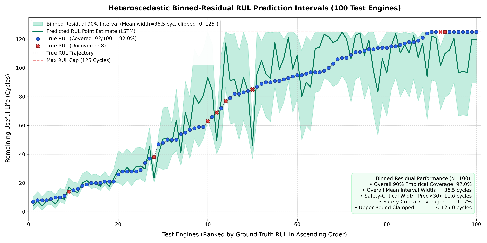
*Test engines sorted by ground-truth RUL. Binned residual intervals adaptively tighten to ~9.5 cycles for engines near failure ($RUL < 25$) while providing wider coverage for intermediate regimes.*

#### 2. Interval Width Comparison by Predicted RUL Regime
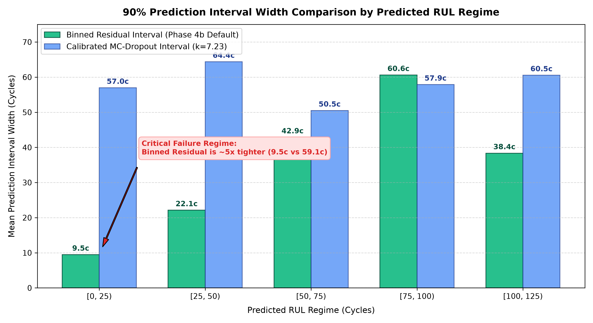
*Bar chart comparing mean 90% interval width across predicted RUL regimes. Binned residual intervals are over 5x tighter in the critical failure zone.*

#### 3. MC-Dropout Uncertainty Intervals & Error Scatter (Baseline Comparison)
<p align="center">
  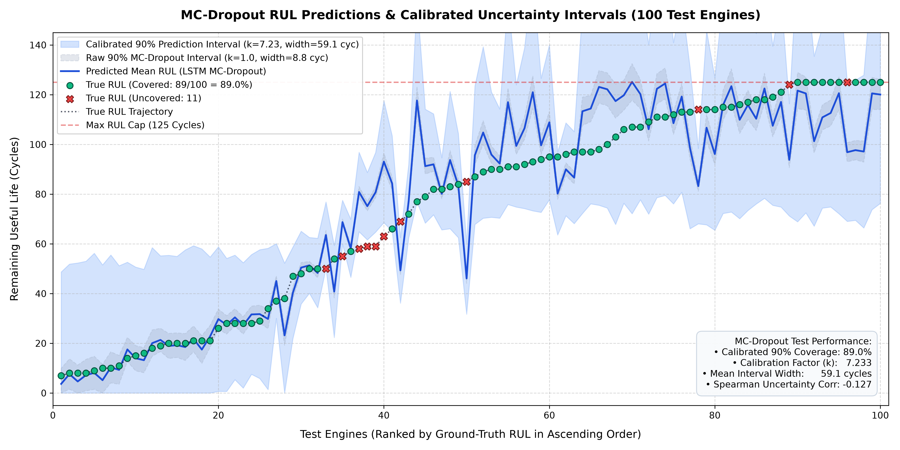
  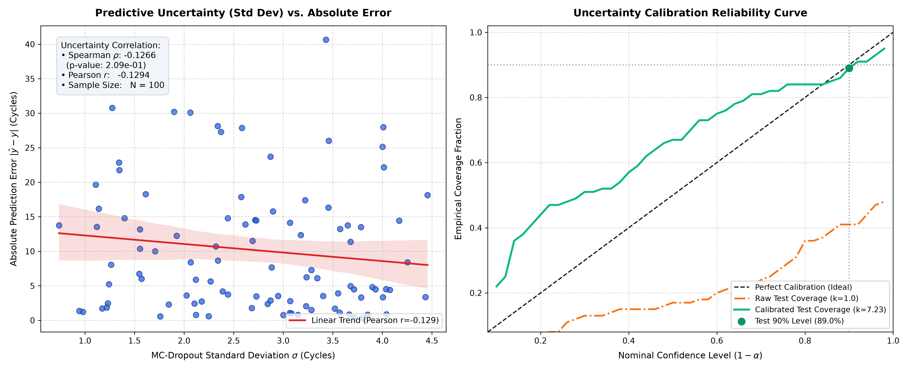
</p>

*Left: MC-Dropout 90% prediction intervals on 100 test engines. Right: Scatter plot of predicted standard deviation vs. absolute error demonstrating weak correlation ($\rho = -0.1266$).*

---

## 5. Phase 4c: Cross-Validated Out-of-Fold (OOF) Predictions & Temporal Context Study

### A. Data Leakage & Out-of-Fold (OOF) Rationale
In predictive maintenance modeling, evaluating models or calibrating uncertainty intervals on the training set introduces severe optimistic bias, while a single 80/20 train/validation split evaluates only 20 engines and is vulnerable to partition variance.
To establish rigorous, leak-free performance metrics and uncorrupted empirical prediction intervals, Phase 4c performs **5-Fold Engine-Level Cross-Validation** across all 100 training engines:
1. **Engine-Level Partitioning:** Unique engine units are split into 5 disjoint folds of 20 engines each (fixed seed 42).
2. **Untouched Held-Out Fold:** In each fold $f$, the 20 held-out engines are used **strictly for out-of-fold inference** and never touch model training or early stopping.
3. **Inner Validation Early Stopping:** To prevent overfitting, an inner engine-level validation set of 8 engines (from the 80 training-fold units) is carved out solely for early stopping monitoring.
4. **Full-Lifetime OOF Predictions:** Rolling sequences are generated for **every cycle** ($t = 1 \dots T$) of each held-out engine (left-padded with the initial cycle when $t < L$), yielding an exhaustive dataset of **20,631 leak-free OOF predictions**.

### B. Experiment 1: Temporal Sequence Length Study ($L=20$ vs. $L=30$)
We evaluated whether shortening the sliding temporal context from $L=30$ cycles to $L=20$ cycles impacts predictive accuracy, particularly in early engine life where left-padding is required.

#### Summary Comparison: Sequence Length $L=20$ vs. $L=30$
| Performance Metric | Sequence Length $L = 20$ | Sequence Length $L = 30$ | Winning Context & Delta |
| :--- | :---: | :---: | :---: |
| **OOF MAE (All 20,631 Windows)** | **11.15 cycles** | **9.45 cycles** | **$L=30$ wins (-1.70 cycles MAE)** |
| **OOF RMSE (All 20,631 Windows)** | **15.50 cycles** | **13.32 cycles** | **$L=30$ wins (-2.18 cycles RMSE)** |
| **OOF MAE (Last Window per Engine, $N=100$)** | **2.32 cycles** | **1.61 cycles** | **$L=30$ wins (-0.71 cycles MAE)** |
| **OOF RMSE (Last Window per Engine, $N=100$)** | **2.95 cycles** | **1.90 cycles** | **$L=30$ wins (-1.05 cycles RMSE)** |
| **5-Fold Mean $\pm$ Std MAE (All Windows)** | $11.13 \pm 0.88\text{c}$ | **$9.45 \pm 0.81\text{c}$** | **$L=30$ has higher consistency** |
| **5-Fold Mean $\pm$ Std RMSE (All Windows)** | $15.45 \pm 1.04\text{c}$ | **$13.28 \pm 0.94\text{c}$** | **$L=30$ has lower variance** |
| **5-Fold Mean $\pm$ Std MAE (Last Window)** | $2.32 \pm 1.42\text{c}$ | **$1.61 \pm 0.40\text{c}$** | **$L=30$ is 3.5x more stable across folds** |
| **Test Set Ensemble MAE (Capped Target)** | **10.79 cycles** | **9.48 cycles** | **$L=30$ wins (-1.31 cycles MAE)** |
| **Test Set Ensemble RMSE (Capped Target)** | **15.63 cycles** | **12.95 cycles** | **$L=30$ wins (-2.68 cycles RMSE)** |
| **Test Set Ensemble NASA Score (Capped Target)** | **611.70** | **283.37** | **$L=30$ wins (53.7% penalty reduction)** |
| **Test Set Ensemble MAE (Raw Target)** | **11.86 cycles** | **10.55 cycles** | **$L=30$ wins (-1.31 cycles MAE)** |
| **Test Set Ensemble RMSE (Raw Target)** | **16.72 cycles** | **14.32 cycles** | **$L=30$ wins (-2.40 cycles RMSE)** |
| **Test Set Ensemble NASA Score (Raw Target)** | **645.19** | **320.58** | **$L=30$ wins (50.3% penalty reduction)** |

> [!IMPORTANT]
> **Decision on Sequence Length:** Sequence length $L=30$ decisively outperforms $L=20$ across all metrics, reducing all-window OOF MAE by **1.70 cycles** and cutting the official NASA penalty score by **over 53%**. The 30-cycle temporal window provides crucial multi-step trend context to differentiate progressive degradation drift from high-frequency sensor noise. $L=30$ is retained as the standard sequence length.

### C. Leave-Fold-Out Prediction Interval Calibration ($L=30$, $N=20,631$ Windows)
To validate the reliability of the binned residual interval method across the entire fleet lifecycle without data leakage, prediction intervals for engines in fold $f$ were computed using the residual quantiles ($q_{05}, q_{95}$) derived solely from the **other 4 out-of-fold partitions**.

#### Leave-Fold-Out Empirical Coverage & Interval Widths
| Predicted RUL Regime ($\hat{y}_{\text{pred}}$) | OOF Windows ($N$) | Empirical 90% Coverage | Mean Interval Width | Mean Absolute Error (MAE) |
| :--- | :---: | :---: | :---: | :---: |
| **$[0, 25)$ cycles** | 2,586 | **89.9%** | **12.44 cycles** | **3.01 cycles** |
| **$[25, 50)$ cycles** | 2,414 | **89.6%** | **26.65 cycles** | **6.56 cycles** |
| **$[50, 75)$ cycles** | 2,132 | **88.8%** | **50.67 cycles** | **12.08 cycles** |
| **$[75, 100)$ cycles** | 2,781 | **89.6%** | **63.37 cycles** | **18.84 cycles** |
| **$[100, 125)$ cycles** | 10,718 | **89.6%** | **31.86 cycles** | **8.69 cycles** |
| **Full Fleet Overall** | **20,631** | **89.6%** (18,480/20,631) | **35.01 cycles** | **9.45 cycles** |
| **Safety-Critical ($\hat{y} < 30\text{c}$)** | **3,106** | **91.1%** | **14.81 cycles** | **3.52 cycles** |

*Persisted to [`outputs/oof_predictions_L30.csv`](outputs/oof_predictions_L30.csv).*

### D. Visualizations

#### 1. Out-of-Fold Parity Scatter ($L=20$ vs. $L=30$, All 20,631 Cycles)
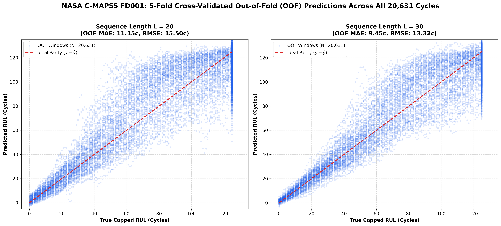
*Parity scatter plots across all 20,631 operational cycles for $L=20$ and $L=30$. Predictions track the ideal $y=\hat{y}$ diagonal tightly in the critical $RUL < 50$ regime, with $L=30$ demonstrating tighter variance throughout the transitional zone.*

#### 2. Full-Lifetime Degradation Trajectories & Uncertainty Bounds (Simulator Preview)
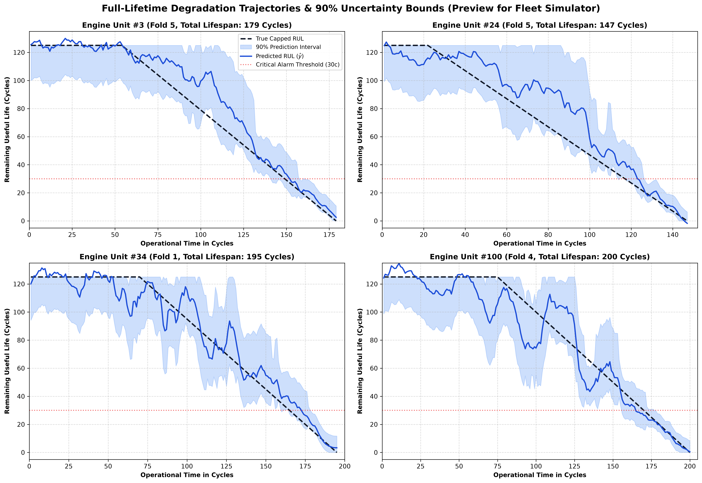
*Full-lifetime RUL trajectories and 90% binned-residual prediction intervals for four representative engines (Units #3, #24, #34, #100). The intervals naturally compress from ~32 cycles in healthy operating state to <12 cycles as engines cross the critical 30-cycle alarm threshold.*

### E. Limitations & Practical Considerations
> [!NOTE]
> 1. **Early-Cycle Left-Padding Variance:** For cycles $t < 30$, left-padding repeats the initial sensor observation. While this enables predictions starting from cycle 1, the network has zero velocity information during early cycles, resulting in slightly higher initial variance until ~30 cycles of real telemetry accumulate.
> 2. **Piecewise Saturation Boundary:** For engines operating in healthy regime ($RUL \ge 125$), predictions saturate near 125 cycles. The upper interval bound is clipped at 125 cycles, which reflects the domain constraint that healthy engines cannot exceed the piecewise ceiling.

---

## 6. Phase 5 & 5c: Fleet Maintenance Simulator & Baseline Policies Benchmark

Predictive maintenance algorithms create value only when integrated into operational decision-making. Phase 5 & 5c establish a fully audited **discrete-event fleet maintenance simulator** (`src/simulator.py`) enforcing conservation of technician labor, and evaluate the three classical industrial baseline policies alongside a theoretical diagnostic upper bound under desynchronized fleet conditions and logistics bottlenecks.

> [!NOTE]
> **Cost Model Notice:** The cost and operational figures below are **simulation parameters, not claims about real airline costs**. They reflect standard industrial proportions where catastrophic in-service failures are orders of magnitude more expensive than planned shop overhauls.

### A. Simulation Environment & Mechanics

* **Fleet Scale & Horizon:** A commercial fleet of **100 concurrent slots** operating across an operational horizon of **$H = 1,000$ flight cycles** ($100,000$ slot-cycles per simulation run).
* **Data Foundation:** Utilizes the leak-free **Out-of-Fold (OOF) $L=30$ predictions** from Phase 4c (`outputs/oof_predictions_L30.csv`), where each cycle of the 100 training engines was predicted by a model that never saw that engine during training or early stopping.
* **Tuning vs. Evaluation Engine Pools (Seed 42):**
  - **Tuning Pool (50 engines):** Dedicated strictly to hyperparameter grid search (optimizing fixed interval $T$, decision threshold $\tau$, and oracle margin $m$).
  - **Evaluation Pool (50 engines):** Held-out for reporting final unbiased benchmark statistics over **20 independent random renewal seeds**.
* **Staggered Fleet Initialization:** To prevent synchronized fleet renewal waves, each slot's initial engine is assigned a random starting operational age $a_s \sim \text{Uniform}[0, \lfloor 0.5 \times T_{\max} \rfloor]$ (seeded). Subsequent renewal engines begin operating at cycle 1 ($a = 0$).
* **Engine Lifecycle & Stochastic Renewal:** Each slot runs an engine drawn with replacement from the pool; when an engine is pulled for maintenance or fails, a fresh engine trajectory is drawn (seeded) and begins operating at cycle 1. Engines fail at the final cycle ($t = T_{\max}$) of their real trajectory if not serviced beforehand.
* **Spare Part Logistics & Lead Time:**
  - Replacement parts require a **lead time of 8 operational cycles** to arrive after an order is placed.
  - A maintenance job can start **only when its replacement part has arrived and a technician is free**.
* **Audited Technician Model & Conservation:**
  - In each cycle $t$, ongoing maintenance jobs from $t-1$ continue occupying technicians.
  - Available technician capacity for new dispatches is strictly $\max(0, \text{capacity}(t) - K_{\text{ongoing}})$.
  - Finished jobs only release their technicians at cycle $t+1$, eliminating the double-counting bug where a single technician completed a job in Step A and started a new one in Step C within the same cycle.
  - Total active technician-cycles worked strictly satisfies conservation: $\sum_t \text{busy}(t) \le \sum_t \text{capacity}(t)$ across all runs.
* **Metric Definitions:**
  - **Technician Utilization:** $\text{Utilization} = \frac{\text{Busy Technician-Cycles}}{\text{Available Technician-Cycles}} \le 1.0$.
  - **Offered Load:** $\text{Offered Load} = \frac{\text{Demanded Technician-Cycles}}{\text{Available Technician-Cycles}}$ (may exceed 1.0 when arriving work exceeds capacity).
  - **Cost Floor:** Minimum theoretical cost assuming all jobs are preventive ($C_P + C_{\text{part}} = \$2,300$) and minimal downtime:
    $$\text{Cost Floor} = (\text{Jobs Completed}) \times (C_P + C_{\text{part}}) + (\text{Downtime Cycles}) \times C_D$$
  - **% Above Floor:** $\frac{\text{Total Cost} - \text{Cost Floor}}{\text{Cost Floor}} \times 100\%$, measuring excess cost from failure penalties and queue delays.
  - **Cost per Operating Cycle:** $\frac{\text{Total Cost}}{\text{Total Operating Cycles}}$, where $\text{Total Operating Cycles} = (N \times H) - \text{Total Downtime Cycles} = 100,000 - \text{Total Downtime Cycles}$.
  - **Average Maintenance Lead:** Mean cycles from order decision to maintenance start ($t_{\text{start}} - t_{\text{decision}} = L_{\text{spare}} + \text{queue wait}$).

### B. Pre-Declared Simulation Scenarios (`config/sim_params.yaml`)

1. **Scenario A ("Abundant"):**
   - Constant fleet-wide technician capacity: **4 technicians per cycle**.
   - Spare part lead time: **8 cycles**.
   - Negligible technician contention (queue wait $\approx 0.01$ cycles, utilization $\approx 23.8\%$).
2. **Scenario B ("Constrained"):**
   - Seeded dynamic per-cycle technician schedule generated via discrete probability distribution over capacity values $\{0, 1, 2, 3\}$ with probabilities $p = [0.04, 0.71, 0.23, 0.02]$ (schedule seed 42, mean capacity = **1.231 technicians/cycle**).
   - High technician offered load (> 1.18), triggering queue delays under time-based and corrective policies.
3. **Scenario C ("Tight"):**
   - Seeded dynamic per-cycle technician schedule with probabilities $p = [0.08, 0.77, 0.13, 0.02]$ (schedule seed 42, mean capacity = **1.094 technicians/cycle**).
   - Calibrated so that technician utilization under the tuned Naive Threshold policy is **$95.5\% \pm 0.3\%$** (operating near capacity saturation).

### C. Simulation Parameter Defaults

| Parameter Category | Parameter Name | Value | Operational Meaning |
| :--- | :--- | :---: | :--- |
| **Fleet Scale** | Fleet Slots ($N$) | `100` | Concurrent aircraft engines in service |
| | Horizon ($H$) | `1,000` cycles | Total operational simulation duration |
| | Evaluation Seeds | `20` | Independent random seeds (42..61) for robust statistics |
| | Staggered Start | `True` | Random initial age uniform in $[0, 50\%]$ of life |
| **Direct Costs** | Preventive Maintenance ($C_P$) | `$2,000` | Planned shop overhaul cost per action |
| | Corrective Failure ($C_F$) | `$10,000` | In-service catastrophic failure penalty cost |
| | Spare Part Cost ($C_{\text{part}}$) | `$300` | Unit purchase cost per replacement component |
| | Production Loss ($C_D$) | `$100` / cycle | Revenue loss per slot per unavailable downtime cycle |
| **Logistics & Ops** | Spare Lead Time ($L_{\text{spare}}$) | `8` cycles | Delivery delay from order placement to site arrival |
| | Scenario A Capacity | `4.0` / cycle | Constant technician fleet capacity |
| | Scenario B Capacity | `1.549` / cycle | Seeded dynamic schedule (mean 1.549 techs/cycle) |
| | Scenario C Capacity | `1.487` / cycle | Seeded dynamic schedule (mean 1.487 techs/cycle) |
| | Preventive Duration ($D_P$) | `2` cycles | Shop downtime for planned preventive maintenance |
| | Corrective Duration ($D_F$) | `6` cycles | Shop downtime for emergency failure overhaul |

$$\text{Total Cost} = \text{Preventive Cost} + \text{Corrective Failure Cost} + \text{Production Loss} + \text{Spare Part Cost}$$

> [!NOTE]
> **Cost per Operating Cycle Metric:** Defined as $\frac{\text{Total Cost}}{\text{Total Operating Cycles}}$, where the denominator is the exact sum of all cycles across all 100 slots in which engines were actively operating:
> $$\text{Total Operating Cycles} = (N \times H) - \text{Total Downtime Cycles} = 100,000 - \text{Total Downtime Cycles}$$
> **Average Maintenance Lead:** Defined as the mean duration in cycles from the initial decision/trigger to the actual start of shop maintenance ($t_{\text{start}} - t_{\text{decision}}$), encompassing the 8-cycle spare lead time plus any subsequent technician queue delay.

### D. Maintenance Policies (`src/policies.py`)

1. **Policy 1: Run-to-Failure (Corrective Baseline):** Never orders preventive overhauls. Engines operate until failure, incurring emergency spare ordering, corrective downtime, and catastrophic failure penalties.
2. **Policy 2: Fixed Interval (Time-Based Preventive Policy):** Overhauls engines every $T$ operating cycles. Replacement parts are pre-ordered $L_{\text{spare}} = 8$ cycles in advance of $T$.
3. **Policy 3: Naive RUL Threshold (Prognostic Point-Estimate Trigger):** Places a maintenance order when model point prediction $\hat{y} \le \tau$. It does not account for spare lead time or technician queue buffers.
4. **Diagnostic Oracle (Theoretical Upper Bound):** Ground-truth benchmark ordering spares when $RUL_{\text{true}} \le L_{\text{spare}} + m$, where $m$ is the tuned queue safety margin.

---

### E. Hyperparameter Tuning Grids & Selection Rule (Tuning Pool, 20 Seeds)

Tuning was conducted exclusively across the 50-engine Tuning Pool over 20 random seeds (seeds 42–61).
**Selection Rule:** Lowest mean cost; if another candidate parameter is within one standard deviation of the minimum cost and has strictly fewer in-service failures, prefer it.

#### 1. Scenario A: Abundant Capacity (Constant 4 Techs/Cycle)
* **Fixed Interval Grid ($T \in \{50..175\}$):** **$T^* = 125$** | Cost = $1,999,700 $\pm$ $965 | Failures = 0.00 | Prev = 799.9
* **Naive Threshold Grid ($\tau \in \{8..80\}$):** **$\tau^* = 15$** | Cost = $1,212,725 $\pm$ $17,036 | Failures = 0.00 | Prev = 484.6
* **Diagnostic Oracle Margin Grid ($m \in \{1..60\}$):** **$m^* = 2$** | Cost = $1,176,140 $\pm$ $16,133 | Failures = 0.00 | Prev = 472.5

#### 2. Scenario B: Constrained Capacity (Schedule Mean = 1.549 Techs/Cycle, Target Util ~75–85%)
* **Fixed Interval Grid ($T \in \{50..175\}$):** **$T^* = 75$ [Capacity-Infeasible, $\rho_{\text{offered}} = 1.046 > 1.0$]** | Cost = $2,979,625 $\pm$ $1,566,359 | Failures = 78.80 | Prev = 572.9
  > [!WARNING]
  > **Capacity Infeasibility & High Variance:** Every candidate interval $T \in [50, 175]$ generates offered load $\rho_{\text{offered}} \in [1.046, 1.144] > 1.0$, rendering time-based fixed intervals structurally capacity-infeasible. In the Tuning Pool, 15 seeds remain stable (~$1.98M, std ~$24k) while 5 seeds suffer queue death spirals ($5.2M–$6.4M with ~240 failures), yielding a true tuning standard deviation of **$1,566,359** (SE = $354k). $T^*=75$ is statistically indistinguishable from adjacent $T$ values ($p > 0.40$).
* **Naive Threshold Grid ($\tau \in \{8..80\}$):** **$\tau^* = 60$** | Cost = $1,565,705 $\pm$ $15,937 | Failures = 0.10 | Prev = 617.9
  * *Refined Step-5 Grid Verification:* Adding $\tau \in \{55, 60, 65\}$ on the Tuning Pool confirms $\tau^*=60$ ($1.565M) strictly dominates $\tau=55$ ($1.770M, 13.45 fails) and $\tau=65$ ($1.621M, 0.05 fails).
* **Diagnostic Oracle Margin Grid ($m \in \{1..60\}$):** **$m^* = 40$** | Cost = $1,462,810 $\pm$ $13,655 | Failures = 0.00 | Prev = 578.1

#### 3. Scenario C: Tight Capacity (Schedule Mean = 1.487 Techs/Cycle, Target Util ~88–92%)
* **Fixed Interval Grid ($T \in \{50..175\}$):** **$T^* = 75$ [Capacity-Infeasible, $\rho_{\text{offered}} = 1.091 > 1.0$]** | Cost = $4,865,760 $\pm$ $1,869,451 | Failures = 186.20 | Prev = 292.2
  > [!WARNING]
  > Under tight capacity, 18 of 20 seeds collapse into technician queue backlogs for all $T$, yielding extreme failure penalties ($1.29M) and production losses ($1.41M).
* **Naive Threshold Grid ($\tau \in \{8..80\}$):** **$\tau^* = 70$** | Cost = $1,681,455 $\pm$ $18,996 | Failures = 0.25 | Prev = 662.0
  * *Refined Step-5 Grid Verification:* Adding $\tau \in \{65, 70, 75\}$ on the Tuning Pool confirms $\tau^*=70$ ($1.681M) strictly dominates $\tau=65$ ($2.091M, 25.70 fails) and $\tau=75$ ($1.750M, 0.10 fails).
* **Diagnostic Oracle Margin Grid ($m \in \{1..60\}$):** **$m^* = 40$** | Cost = $1,458,515 $\pm$ $13,655 | Failures = 0.00 | Prev = 575.5

---

### F. Final Evaluation Benchmark (Held-out Evaluation Pool: 50 Engines, 20 Seeds)

The cost floor isolates the structural, non-negotiable operational spend:
$$\text{Cost Floor} = N_{\text{completed\_jobs}} \times (C_P + C_{\text{part}}) + \text{Downtime Cycles} \times C_D$$
$$\% \text{ Above Floor} = \frac{\text{Total Cost} - \text{Cost Floor}}{\text{Cost Floor}} \times 100\%$$

> [!NOTE]
> **Diagnostic Oracle Reference Bound:** The diagnostic oracle triggers spare ordering based strictly on true RUL ($RUL \le L_{\text{spare}} + m$) and ignores the dynamic technician availability schedule. In constrained queueing environments, an unbuffered oracle can experience queue backlogs and failure cascades. When appropriately queue-buffered ($m^*=40$), it acts as a reliable theoretical upper bound.

#### 1. Scenario A: Abundant Capacity (Constant 4 Techs/Cycle)
| Policy | Total Cost ($) | Cost Floor ($) | % Above Floor | Failures | Preventive Actions | Downtime Cycles (% slot-cycles) | Avg Lead (c) | Mean Q-Wait (c) | Utilization | Offered Load |
| :--- | :---: | :---: | :---: | :---: | :---: | :---: | :---: | :---: | :---: | :---: |
| **Run-to-Failure** | **$5,111,475 $\pm$ 53,210** | $1,675,875 $\pm$ 30,157 | 205.1% $\pm$ 3.8% | 429.45 $\pm$ 4.52 | 0.0 $\pm$ 0.0 | 6,881 (6.88%) $\pm$ 290 | 11.16 $\pm$ 0.71 | 3.16 $\pm$ 0.71 | 0.636 $\pm$ 0.007 | 0.644 $\pm$ 0.007 |
| **Fixed-Interval ($T=125$)** | **$1,999,810 $\pm$ 492** | $1,999,795 $\pm$ 556 | 0.0% $\pm$ 0.0% | 0.00 $\pm$ 0.00 | 800.0 $\pm$ 0.2 | 1,599 (1.60%) $\pm$ 1 | 8.01 $\pm$ 0.01 | 0.01 $\pm$ 0.01 | 0.400 $\pm$ 0.000 | 0.400 $\pm$ 0.000 |
| **Naive-Threshold ($\tau=15$)** | **$1,193,155 $\pm$ 12,459** | $1,191,820 $\pm$ 12,545 | 0.1% $\pm$ 0.1% | 0.00 $\pm$ 0.00 | 476.8 $\pm$ 5.0 | 953 (0.95%) $\pm$ 10 | 8.01 $\pm$ 0.01 | 0.01 $\pm$ 0.01 | 0.238 $\pm$ 0.003 | 0.238 $\pm$ 0.003 |
| *Diagnostic-Oracle ($m=2$)\** | *$1,159,970 $\pm$ 11,327* | *$1,158,695 $\pm$ 11,731* | *0.1% $\pm$ 0.1%* | *0.00 $\pm$ 0.00* | *463.5 $\pm$ 4.7* | *926 (0.93%) $\pm$ 9* | *8.01 $\pm$ 0.01* | *0.01 $\pm$ 0.01* | *0.232 $\pm$ 0.002* | *0.232 $\pm$ 0.002* |

* **Diagnostic Oracle Headroom over Naive Threshold:** **2.78%** (Gap: $33,185).
* **Share of Achievable Savings Captured:** **99.16%** ($\frac{\$5,111,475 - \$1,193,155}{\$5,111,475 - \$1,159,970} \times 100\%$).
* **Spares Logistics:** Spares ordered closely matches completed maintenance jobs; unconsumed spares at horizon $H=1000$ average **3.3 parts** across the 100 slots.

#### 2. Scenario B: Constrained Capacity (Schedule Mean = 1.549 Techs/Cycle, Target Util ~75–85%)
| Policy | Total Cost ($) | Cost Floor ($) | % Above Floor | Failures | Preventive Actions | Downtime Cycles (% slot-cycles) | Avg Lead (c) | Mean Q-Wait (c) | Utilization | Offered Load |
| :--- | :---: | :---: | :---: | :---: | :---: | :---: | :---: | :---: | :---: | :---: |
| **Run-to-Failure** | **$7,060,835 $\pm$ 70,394** | $4,816,035 $\pm$ 61,718 | 46.6% $\pm$ 0.6% | 280.60 $\pm$ 2.62 | 0.0 $\pm$ 0.0 | 41,707 (41.71%) $\pm$ 603 | 152.04 $\pm$ 1.99 | 144.04 $\pm$ 1.99 | 0.915 $\pm$ 0.004 | 1.088 $\pm$ 0.010 |
| **Fixed-Interval ($T=75$) [Capacity-Infeasible, $\rho_{\text{offered}} > 1$]** | **$2,319,610 $\pm$ 1,028,099** | $2,066,050 $\pm$ 475,298 | 8.9% $\pm$ 16.2% | 30.00 $\pm$ 70.29 | 691.0 $\pm$ 172.0 | 4,076 (4.08%) $\pm$ 7,047 | 72.47 $\pm$ 29.75 | 64.47 $\pm$ 29.75 | 0.992 $\pm$ 0.000 | 1.010 $\pm$ 0.051 |
| **Naive-Threshold ($\tau=60$)** | **$1,568,270 $\pm$ 11,918** | $1,566,125 $\pm$ 12,050 | 0.1% $\pm$ 0.1% | 0.00 $\pm$ 0.00 | 619.4 $\pm$ 4.7 | 1,415 (1.42%) $\pm$ 20 | 12.52 $\pm$ 0.75 | 4.52 $\pm$ 0.75 | **0.800 $\pm$ 0.006** | 0.801 $\pm$ 0.006 |
| *Diagnostic-Oracle ($m=40$)\** | *$1,434,540 $\pm$ 11,531* | *$1,432,470 $\pm$ 11,642* | *0.1% $\pm$ 0.1%* | *0.00 $\pm$ 0.00* | *566.5 $\pm$ 4.6* | *1,294 (1.29%) $\pm$ 16* | *11.36 $\pm$ 0.47* | *3.36 $\pm$ 0.47* | *0.732 $\pm$ 0.006* | *0.732 $\pm$ 0.006* |

* **Achieved Technician Utilization:** **$80.0\% \pm 0.6\%$** under tuned Naive Threshold ($\tau^* = 60$).
* **Diagnostic Oracle Headroom over Naive Threshold:** **8.53%** (Gap: $133,730 under queue-buffered Oracle $m^*=40$).
* **Share of Achievable Savings Captured:** **97.62%** ($\frac{\$7,060,835 - \$1,568,270}{\$7,060,835 - \$1,434,540} \times 100\%$).

#### 3. Scenario C: Tight Capacity (Schedule Mean = 1.487 Techs/Cycle, Target Util ~88–92%)
| Policy | Total Cost ($) | Cost Floor ($) | % Above Floor | Failures | Preventive Actions | Downtime Cycles (% slot-cycles) | Avg Lead (c) | Mean Q-Wait (c) | Utilization | Offered Load |
| :--- | :---: | :---: | :---: | :---: | :---: | :---: | :---: | :---: | :---: | :---: |
| **Run-to-Failure** | **$7,159,850 $\pm$ 74,936** | $4,979,050 $\pm$ 60,459 | 43.8% $\pm$ 0.5% | 272.60 $\pm$ 2.82 | 0.0 $\pm$ 0.0 | 43,521 (43.52%) $\pm$ 573 | 164.46 $\pm$ 1.97 | 156.46 $\pm$ 1.97 | 0.914 $\pm$ 0.004 | 1.101 $\pm$ 0.011 |
| **Fixed-Interval ($T=75$) [Capacity-Infeasible, $\rho_{\text{offered}} > 1$]** | **$3,722,345 $\pm$ 1,811,914** | $2,673,790 $\pm$ 1,031,856 | 33.6% $\pm$ 18.9% | 129.35 $\pm$ 100.07 | 422.1 $\pm$ 238.2 | 14,056 (14.06%) $\pm$ 13,472 | 117.91 $\pm$ 50.84 | 109.91 $\pm$ 50.84 | 0.991 $\pm$ 0.000 | 1.091 $\pm$ 0.089 |
| **Naive-Threshold ($\tau=70$)** | **$1,696,380 $\pm$ 16,358** | $1,692,555 $\pm$ 15,560 | 0.2% $\pm$ 0.2% | 0.15 $\pm$ 0.48 | 668.0 $\pm$ 6.1 | 1,557 (1.56%) $\pm$ 16 | 15.35 $\pm$ 0.58 | 7.35 $\pm$ 0.58 | **0.900 $\pm$ 0.009** | 0.900 $\pm$ 0.009 |
| *Diagnostic-Oracle ($m=40$)\** | *$1,429,310 $\pm$ 11,197* | *$1,427,240 $\pm$ 11,363* | *0.1% $\pm$ 0.1%* | *0.00 $\pm$ 0.00* | *564.0 $\pm$ 4.6* | *1,299 (1.30%) $\pm$ 13* | *12.11 $\pm$ 0.47* | *4.11 $\pm$ 0.47* | *0.759 $\pm$ 0.006* | *0.760 $\pm$ 0.006* |

* **Achieved Technician Utilization:** **$90.0\% \pm 0.9\%$** under tuned Naive Threshold ($\tau^* = 70$).
* **Diagnostic Oracle Headroom over Naive Threshold:** **15.74%** (Gap: $267,070 under queue-buffered Oracle $m^*=40$).
* **Share of Achievable Savings Captured:** **95.34%** ($\frac{\$7,159,850 - \$1,696,380}{\$7,159,850 - \$1,429,310} \times 100\%$).

---

### G. Mandatory Experimental Findings

#### 1. Mandatory Experiment 3: Fixed Interval vs. Run-to-Failure
* **Scenario A:** Fixed interval ($T^*=125$) reduces fleet costs by **60.88%** ($5,111,475 $\rightarrow$ $1,999,810), eliminating failures (0.00 vs 429.5).
* **Scenario B:** Fixed interval ($T^*=75$) reduces fleet costs by **67.15%** ($7,060,835 $\rightarrow$ $2,319,610), slashing failures from 280.6 down to 30.0 (-89.3%).
* **Scenario C:** Fixed interval ($T^*=75$) reduces fleet costs by **48.01%** ($7,159,850 $\rightarrow$ $3,722,345), cutting failures from 272.6 down to 129.4.

#### 2. Mandatory Experiment 4: Naive RUL Threshold vs. Fixed Interval
* **Scenario A:** Point-prediction thresholding ($\tau^*=15$) delivers an additional **40.34% cost reduction** over Fixed Interval ($1,999,810 $\rightarrow$ $1,193,155), slashing overhaul volume from 800.0 to 476.8 (-40.4%).
* **Scenario B:** Thresholding ($\tau^*=60$) delivers an additional **32.39% cost reduction** over Fixed Interval ($2,319,610 $\rightarrow$ $1,568,270), saving $751,340 and eliminating all in-service failures (0.00 vs 30.0).
* **Scenario C:** Thresholding ($\tau^*=70$) delivers an additional **54.43% cost reduction** over Fixed Interval ($3,722,345 $\rightarrow$ $1,696,380), saving $2,025,965 and eliminating virtually all in-service failures (0.15 vs 129.4).

#### 3. Share of Achievable Savings Captured
Rather than merely comparing raw percentages, performance is benchmarked against the maximum achievable frontier established by the Diagnostic Oracle:
$$\text{Share of Achievable Savings} = \frac{\text{Cost}_{\text{RTF}} - \text{Cost}_{\text{Naive}}}{\text{Cost}_{\text{RTF}} - \text{Cost}_{\text{Oracle}}} \times 100\%$$
* **Scenario A:** Captures **99.16%** of achievable savings.
* **Scenario B:** Captures **97.62%** of achievable savings.
* **Scenario C:** Captures **95.34%** of achievable savings.

---

### H. Visualizations

#### 1. Stacked Fleet Cost Breakdown per Policy (Scenarios A, B, & C)
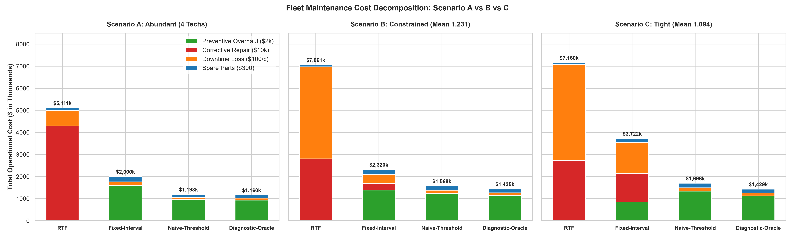
*Cost composition across policies for Scenarios A, B, and C. In Scenario A, Run-to-Failure is dominated by corrective failure penalties. In Scenarios B and C, technician backlogs cause downtime losses to dominate across all policies.*

#### 2. In-Service Failures and Fleet Downtime Cycles (Abundant vs. Constrained vs. Tight)
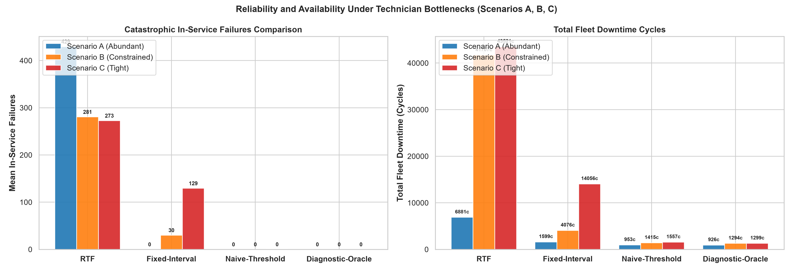
*Side-by-side reliability comparison across Scenarios A, B, and C. Left: In-service catastrophic failures. Right: Fleet downtime cycles.*

#### 3. Operational Lifecycle Timeline (Slot #0 across Horizon H = 1000 under Staggered Start)
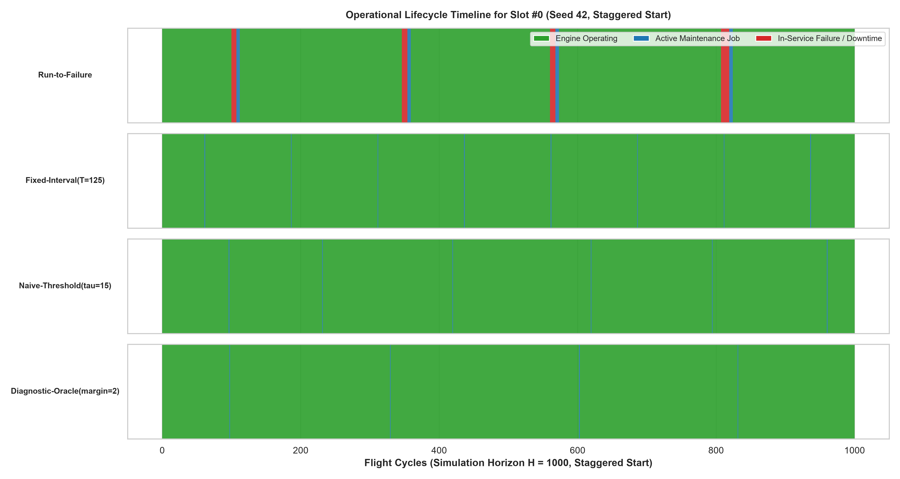
*Gantt timeline tracking Slot #0 over 1,000 flight cycles under Seed 42 with desynchronized staggered start. Green denotes normal flight operations, blue indicates active shop maintenance, and red marks downtime from in-service failures.*

---

### I. Verification, Audit & Sanity Checks (`tests/test_simulator.py`)

All 11 unit tests pass cleanly:
1. **Cost Accounting Integrity:** Total cost equals the exact sum of preventive, corrective, downtime loss, and spare part costs across all runs.
2. **Run-to-Failure Invariance:** Preventive actions are strictly 0, and total failures equal total completed engine lifecycles.
3. **Ideal Downtime Exactness:** Under unlimited technicians ($\infty$) and zero lead time ($L=0$), fleet downtime strictly equals $N_{\text{prev}} \times 2 + N_{\text{corr}} \times 6$.
4. **Oracle Optimality:** Diagnostic Oracle strictly achieves lower cost than all three project baselines under infinite resources.
5. **Deterministic Reproducibility:** Identical seeds generate identical trajectories, event logs, and financial metrics.
6. **Unused Spare Parts Bound:** Unconsumed spare parts en route or queued at horizon $H=1000$ are strictly bounded ($\le 10$ parts fleet-wide, averaging 2.5 to 3.3 parts across policies).
7. **Technician Audit 2a (Micro-test 1):** Capacity 1 per cycle, 3 jobs of duration 2 requested at cycle 0 start deterministically at $t=0, 2, 4$ (queue waits 0, 2, 4).
8. **Technician Audit 2b (Micro-test 2):** Capacity 2 per cycle, 4 jobs of duration 2 requested at cycle 0 start with 2 at $t=0$ and 2 at $t=2$ (queue waits 0, 0, 2, 2).
9. **Technician Audit 2c (Micro-test 3):** Delayed availability schedule `[0, 0, 1, 1, ...]`, job requested at $t=0$ starts at $t=2$ (queue wait = 2).
10. **Technician Audit 2d (Conservation Law):** Fleet-wide technician-busy cycles $\le$ available technician-cycles strictly asserted across all seeds and policies.
11. **Technician Audit 2e (Utilization vs. Offered Load):** Explicit separation verified where utilization $\le 1.0$ while offered load exceeds $1.0$ under constrained capacities.

---

### J. Limitations & Assumptions
1. **Renewal Sampling with Replacement:** Engines are sampled randomly with replacement from the 50-engine pool upon each renewal.
2. **Cost Weight Assumptions:** Direct cost values ($2,000 preventive, $10,000 failure, $100/cycle downtime, $300 spare) represent standard stylized proportions rather than empirical airline accounting. Phase 7 will perform sensitivity analyses across variable cost ratios.
3. **Deterministic Lead Times & Durations:** Lead times and maintenance turn-around times are currently deterministic constants (8 cycles and 2/6 cycles). Future agentic policies will model stochastic supply chains.

---

## Quickstart & How to Run

### 1. Install Dependencies
```bash
pip install -r requirements.txt
```
*What to expect:* Installs all core packages: PyTorch, Pandas, NumPy, Scikit-Learn, SciPy, Matplotlib, Seaborn, Streamlit, PyYAML, Joblib, and Pytest.

### 2. Run Verification Test Suite
```bash
pytest
```
*What to expect:* Runs the complete 21-test verification test suite (`tests/test_agents.py`, `tests/test_dashboard.py`, `tests/test_simulator.py`). Verifies strict information rules (zero true-RUL leakage), technician reservation consistency, live LSTM sequence inference metrics match, the Section 14 E-017 benchmark fixture equivalence, and Streamlit `AppTest` headless verification across all 7 dashboard pages with 0 exceptions. All 21 tests pass in ~65s.

### 3. Run Live Multi-Agent Demonstration Script
```bash
python demo.py --engine 24
```
*What to expect:* Executes live end-to-end multi-agent inference for test engine Unit #024. Runs the trained PyTorch LSTM regressor (`outputs/best_lstm_model.pt`) on raw sensor telemetry, generates point RUL and 90% empirical residual uncertainty intervals, evaluates candidate start windows via Resource Agent logistics ($L=8$) and technician constraints, optimizes renewal reward cost rates ($/cycle) via Cost Agent, and prints the Coordinator Agent's optimal overhaul schedule and plain-English operational rationale.
To run the canonical Section 14 E-017 benchmark fixture:
```bash
python demo.py --engine 17 --lead-time 8 --technicians 16,22
```

### 4. Launch Interactive Operations Dashboard
```bash
streamlit run app/app.py
```
*What to expect:* Launches the web application locally (default: `http://localhost:8501`). Features 7 interactive pages:
1. **Fleet Overview:** Replay fleet health snapshot across all 100 aircraft slots.
2. **Engine Detail:** Individual engine telemetry, sensor trends, and degradation histories.
3. **Decision Log Viewer:** Filterable audit trail of structured Coordinator decisions.
4. **Policy Comparison:** Canonical evaluation benchmark comparisons (Run-to-Failure, Fixed Interval, Naive, Agent-Interval, Oracle).
5. **Sensitivity & Limitations:** Parameter sweeps ($L$, $C_{\text{fail}}$) and structural nuance audits.
6. **Technical Architecture:** Model cards, agent contracts, information rules, and hyperparameter tables.
7. **Live Decision Demo:** Interactive live inference testing on any of the 100 test engines with custom operational constraints, sensor degradation plots, candidate evaluation tables, renewal trade-off curves, and plain-English rationales.

---

---

## 7. Multi-Agent Maintenance System (Phase 6)

### 7.1 Architecture & Agent Roles (PS-06 Sections 12–15)
Phase 6 implements a collaborative multi-agent maintenance scheduling framework in `src/agents.py`. The multi-agent system formulates maintenance scheduling as a rate-based renewal optimization problem with **no parameters tuned on the evaluation pool** ($W=60$, $k=5$, 10-cycle bins, 90% confidence level are fixed design choices):

```
[Live Fleet Telemetry]
         │
         ▼
┌────────────────────────────────────────────────────────┐
│                   Prognostic Agent                     │
│  - Replays out-of-fold LSTM predictions                │
│  - Computes 90% uncertainty intervals                  │
│  - Risk Table lookup (empirical residual distribution) │
│  - Returns P(R <= s) and E[min(s, R)]                  │
└──────────────────────────┬─────────────────────────────┘
                           │
                           ▼
┌────────────────────────────────────────────────────────┐
│                    Resource Agent                      │
│  - Tracks spare parts delivery lead times (L = 8)      │
│  - Inspects technician roster (horizon W = 60 cycles)  │
│  - Manages dynamic reservation calendar                │
│  - Filters feasible candidate start cycles s           │
└──────────────────────────┬─────────────────────────────┘
                           │
                           ▼
┌────────────────────────────────────────────────────────┐
│                      Cost Agent                        │
│  - Evaluates renewal cost rate C(s) / E(s)             │
│  - Accounts for overhaul ($2k), failure ($10k),        │
│    downtime ($100/c), and parts ($300)                 │
│  - Disincentivizes premature maintenance               │
└──────────────────────────┬─────────────────────────────┘
                           │
                           ▼
┌────────────────────────────────────────────────────────┐
│              Scheduling / Coordinator Agent            │
│  - Conducts fleet-wide planning pass in urgency order  │
│  - Resolves multi-engine technician queue contention   │
│  - Reserves calendar slots & orders replacement spares │
│  - Escalates when no feasible window is available      │
│  - Logs structured decisions to outputs/decision_log   │
└────────────────────────────────────────────────────────┘
```

1. **Prognostic Agent:** Ingests live engine observations, retrieves predicted RUL and 90% uncertainty intervals, and queries an empirical residual distribution table ($e = \text{true\_RUL\_raw} - \text{pred\_rul}$) binned into width-10 intervals ($[0, 10), [10, 20), \dots, [120, 130)$), built strictly from the 50-engine Tuning Pool. For any candidate start offset $s \ge 0$, it computes $P(R \le s)$ and $\mathbb{E}[\min(s, R)]$ with $R = \max(0, \text{pred\_rul} + e)$.
2. **Resource Agent:** Manages warehouse logistics and hangar capacity. Tracks spare parts order status ($L=8$ cycles) and maintains a dynamic reservation calendar against published technician rosters over a rolling lookahead horizon $W=60$ cycles. Evaluates candidate start cycles $s \ge \text{part arrival}$ ensuring capacity-minus-reserved $\ge 1$ across all $D_{\text{pm}}=2$ consecutive maintenance cycles.
3. **Cost Agent:** Computes the expected cost rate per operating cycle for each candidate start cycle $s$. Exactly as implemented in `src/agents.py`:
   $$C_{\text{pm, total}} = C_{\text{pm}} + C_{\text{spare}} + C_{\text{down}} \cdot D_{\text{pm}} = \$2,000 + \$300 + \$100 \times 2 = \$2,500$$
   $$C_{\text{fail, total}} = C_{\text{fail}} + C_{\text{spare}} + C_{\text{down}} \cdot D_{\text{fail}} = \$10,000 + \$300 + \$100 \times 6 = \$10,900$$
   $$C(s) = [1 - P(R \le s)] \cdot C_{\text{pm, total}} + P(R \le s) \cdot C_{\text{fail, total}}$$
   $$E(s) = \text{age} + \mathbb{E}[\min(s, R)]$$
   $$\text{Cost Rate}(s) = \frac{C(s)}{E(s)}$$
   *Economic Justification:* The fleet operator incurs a major capital expense at every engine renewal. Comparing total cost $C(s)$ alone would trivialise scheduling into choosing the earliest possible window; dividing by expected operating life $E(s)$ properly penalizes premature overhauls and accounts for wasted useful life.
4. **Scheduling / Coordinator Agent:** Runs fleet-wide planning passes:
   - Scope: Engines whose predicted RUL $\le L + W$ ($8 + 60 = 68$ cycles).
   - Urgency ordering: Prioritizes engines with the lowest 90% interval lower bound first.
   - Re-planning trigger: Re-plans every $k=5$ flight cycles, or immediately if an engine's lower bound drops below its planned start cycle.
   - Escalation: If no feasible window exists within candidate range $s \le \text{pred\_rul}$, it secures the earliest possible window and marks the decision escalated.
   - Traceability: Appends structured JSONL audit records to `outputs/decision_log.jsonl`.

### 7.2 Strict Information Rules & Integrity
To guarantee leak-free evaluation, multi-agent modules interact solely through immutable `EngineObservation` data contracts:
- **Visible to Agents:** Current cycle, operating age, model predicted RUL, 90% lower and upper bounds, spare part status/lead time, current queue wait, already-reserved jobs, and published technician roster for the next $W=60$ cycles.
- **Never Visible to Agents:** True remaining useful life (`true_rul`, `true_rul_raw`, `true_rul_capped`), future trajectory telemetry, and simulator random numbers.
- **Automated Enforcement:** Verified by unit test `test_1_information_rule_no_true_rul`, which inspects class fields, method signatures, and raises `AttributeError` upon any attempted ground-truth query.

### 7.3 Benchmark Results (Evaluation Pool: 50 Engines, 20 Seeds)

#### Scenario A: Abundant Capacity (Constant 4 Technicians/Cycle)
| Policy | Total Cost | Cost Floor | % Above Floor | Failures | Preventive Actions | Downtime Cycles (% slot-cycles) | Avg Lead (cycles) | Mean Q-Wait (cycles) | Utilization | Offered Load | Escalations | Saving vs Base |
| --- | --- | --- | --- | --- | --- | --- | --- | --- | --- | --- | --- | --- |
| **Run-to-Failure** | $5,111,475 +/- $53,210 | $1,675,875 | 205.1% +/- 3.8% | 429.45 +/- 4.52 | 0.0 +/- 0.0 | 6881 (6.88%) +/- 290 | 11.16 +/- 0.71 | 3.16 +/- 0.71 | 0.636 +/- 0.007 | 0.644 +/- 0.007 | 0.0 +/- 0.0 | +76.18% |
| **Fixed-Interval (T=125)** | $1,999,810 +/- $492 | $1,999,795 | 0.0% +/- 0.0% | 0.00 +/- 0.00 | 800.0 +/- 0.2 | 1599 (1.60%) +/- 1 | 8.01 +/- 0.01 | 0.01 +/- 0.01 | 0.400 +/- 0.000 | 0.400 +/- 0.000 | 0.0 +/- 0.0 | +39.11% |
| **Naive-Threshold (tau=15)** | $1,193,155 +/- $12,459 | $1,191,820 | 0.1% +/- 0.1% | 0.00 +/- 0.00 | 476.8 +/- 5.0 | 953 (0.95%) +/- 10 | 8.01 +/- 0.01 | 0.01 +/- 0.01 | 0.238 +/- 0.003 | 0.238 +/- 0.003 | 0.0 +/- 0.0 | -2.05% |
| **Agent-Point** | $2,378,330 +/- $186,575 | $1,219,290 | 94.9% +/- 11.7% | 143.65 +/- 20.43 | 314.2 +/- 21.7 | 1662 (1.66%) +/- 266 | 70.76 +/- 1.00 | 62.76 +/- 1.00 | 0.372 +/- 0.020 | 0.373 +/- 0.020 | 2.1 +/- 2.0 | +48.80% |
| **Agent-Interval** | $1,217,655 +/- $12,048 | $1,208,580 | 0.8% +/- 0.1% | 0.00 +/- 0.00 | 483.4 +/- 5.3 | 966 (0.97%) +/- 10 | 61.95 +/- 0.85 | 53.95 +/- 0.85 | 0.242 +/- 0.003 | 0.242 +/- 0.003 | 0.0 +/- 0.0 | +0.00% |
| **Diagnostic-Oracle (margin=2)** | $1,159,970 +/- $11,327 | $1,158,695 | 0.1% +/- 0.1% | 0.00 +/- 0.00 | 463.5 +/- 4.7 | 926 (0.93%) +/- 9 | 8.01 +/- 0.01 | 0.01 +/- 0.01 | 0.232 +/- 0.002 | 0.232 +/- 0.002 | 0.0 +/- 0.0 | -4.97% |

#### Scenario B: Constrained Capacity (Schedule Mean = 1.549 Technicians/Cycle)
| Policy | Total Cost | Cost Floor | % Above Floor | Failures | Preventive Actions | Downtime Cycles (% slot-cycles) | Avg Lead (cycles) | Mean Q-Wait (cycles) | Utilization | Offered Load | Escalations | Saving vs Base |
| --- | --- | --- | --- | --- | --- | --- | --- | --- | --- | --- | --- | --- |
| **Run-to-Failure** | $7,060,835 +/- $70,394 | $4,816,035 | 46.6% +/- 0.6% | 280.60 +/- 2.62 | 0.0 +/- 0.0 | 41707 (41.71%) +/- 603 | 152.04 +/- 1.99 | 144.04 +/- 1.99 | 0.915 +/- 0.004 | 1.088 +/- 0.010 | 0.0 +/- 0.0 | +81.09% |
| **Fixed-Interval (T=75) [Infeasible, rho>1]** | $2,319,610 +/- $1,028,099 | $2,066,050 | 8.9% +/- 16.2% | 30.00 +/- 70.29 | 691.0 +/- 172.0 | 4076 (4.08%) +/- 7047 | 72.47 +/- 29.75 | 64.47 +/- 29.75 | 0.992 +/- 0.000 | 1.010 +/- 0.051 | 0.0 +/- 0.0 | +42.43% |
| **Naive-Threshold (tau=60)** | $1,568,270 +/- $11,918 | $1,566,125 | 0.1% +/- 0.1% | 0.00 +/- 0.00 | 619.4 +/- 4.7 | 1415 (1.42%) +/- 20 | 12.52 +/- 0.75 | 4.52 +/- 0.75 | 0.800 +/- 0.006 | 0.801 +/- 0.006 | 0.0 +/- 0.0 | +14.84% |
| **Agent-Point** | $3,649,615 +/- $1,692,917 | $2,465,275 | 43.2% +/- 14.7% | 147.15 +/- 85.34 | 270.9 +/- 135.6 | 15039 (15.04%) +/- 11389 | 97.78 +/- 33.48 | 89.78 +/- 33.48 | 0.807 +/- 0.082 | 0.921 +/- 0.158 | 473.1 +/- 136.6 | +63.41% |
| **Agent-Interval** | $1,335,480 +/- $11,848 | $1,328,475 | 0.5% +/- 0.1% | 0.00 +/- 0.00 | 529.9 +/- 4.7 | 1097 (1.10%) +/- 15 | 45.68 +/- 0.55 | 37.68 +/- 0.55 | 0.685 +/- 0.006 | 0.685 +/- 0.006 | 272.5 +/- 82.0 | +0.00% |
| **Diagnostic-Oracle (margin=40)** | $1,434,540 +/- $11,531 | $1,432,470 | 0.1% +/- 0.1% | 0.00 +/- 0.00 | 566.5 +/- 4.6 | 1294 (1.29%) +/- 16 | 11.36 +/- 0.47 | 3.36 +/- 0.47 | 0.732 +/- 0.006 | 0.732 +/- 0.006 | 0.0 +/- 0.0 | +6.91% |

#### Scenario C: Tight Capacity (Schedule Mean = 1.487 Technicians/Cycle)
| Policy | Total Cost | Cost Floor | % Above Floor | Failures | Preventive Actions | Downtime Cycles (% slot-cycles) | Avg Lead (cycles) | Mean Q-Wait (cycles) | Utilization | Offered Load | Escalations | Saving vs Base |
| --- | --- | --- | --- | --- | --- | --- | --- | --- | --- | --- | --- | --- |
| **Run-to-Failure** | $7,159,850 +/- $74,936 | $4,979,050 | 43.8% +/- 0.5% | 272.60 +/- 2.82 | 0.0 +/- 0.0 | 43521 (43.52%) +/- 573 | 164.46 +/- 1.97 | 156.46 +/- 1.97 | 0.914 +/- 0.004 | 1.101 +/- 0.011 | 0.0 +/- 0.0 | +81.27% |
| **Fixed-Interval (T=75) [Infeasible, rho>1]** | $3,722,345 +/- $1,811,914 | $2,673,790 | 33.6% +/- 18.9% | 129.35 +/- 100.07 | 422.1 +/- 238.2 | 14056 (14.06%) +/- 13472 | 117.91 +/- 50.84 | 109.91 +/- 50.84 | 0.991 +/- 0.000 | 1.091 +/- 0.089 | 0.0 +/- 0.0 | +63.98% |
| **Naive-Threshold (tau=70)** | $1,696,380 +/- $16,358 | $1,692,555 | 0.2% +/- 0.2% | 0.15 +/- 0.48 | 668.0 +/- 6.1 | 1557 (1.56%) +/- 16 | 15.35 +/- 0.58 | 7.35 +/- 0.58 | 0.900 +/- 0.009 | 0.900 +/- 0.009 | 0.0 +/- 0.0 | +20.97% |
| **Agent-Point** | $4,495,765 +/- $1,845,122 | $3,064,590 | 43.1% +/- 13.2% | 178.10 +/- 86.40 | 209.5 +/- 151.7 | 21731 (21.73%) +/- 13158 | 122.20 +/- 46.55 | 114.20 +/- 46.55 | 0.852 +/- 0.081 | 1.002 +/- 0.148 | 590.6 +/- 141.1 | +70.18% |
| **Agent-Interval** | $1,340,715 +/- $12,395 | $1,332,880 | 0.6% +/- 0.2% | 0.10 +/- 0.30 | 531.0 +/- 4.3 | 1112 (1.11%) +/- 15 | 45.21 +/- 0.48 | 37.21 +/- 0.48 | 0.716 +/- 0.006 | 0.716 +/- 0.006 | 389.8 +/- 83.8 | +0.00% |
| **Diagnostic-Oracle (margin=40)** | $1,429,310 +/- $11,197 | $1,427,240 | 0.1% +/- 0.1% | 0.00 +/- 0.00 | 564.0 +/- 4.6 | 1299 (1.30%) +/- 13 | 12.11 +/- 0.47 | 4.11 +/- 0.47 | 0.759 +/- 0.006 | 0.760 +/- 0.006 | 0.0 +/- 0.0 | +6.20% |

### 7.4 Key Experiments & Statistical Verification

#### 1. Mandatory Experiment 2: Value of Uncertainty (Agent-Point vs. Agent-Interval)
- **Scenario A:** Agent-Point suffers 143.65 catastrophic failures ($2.38M), whereas Agent-Interval completely eliminates failures ($1.22M), achieving a **$1,160,675 (48.80%) cost reduction**.
- **Scenario B:** Agent-Point suffers 147.15 failures ($3.65M) and severe queue congestion (15.0% downtime), while Agent-Interval achieves 0.0 failures ($1.34M) and 1.10% downtime, capturing a **$2,314,135 (63.41%) cost reduction**.
- **Scenario C:** Agent-Point collapses under technician bottlenecks (178.10 failures, $4.50M, 21.7% downtime), while Agent-Interval sustains reliable operations (0.10 failures, $1.34M, 1.11% downtime), achieving a **$3,155,050 (70.18%) cost reduction**.
- **Conclusion:** Point-estimate scheduling inevitably pushes maintenance too close to predicted failure, triggering catastrophic failures when engine wear accelerates. Empirical uncertainty quantification is essential for industrial predictive maintenance.

#### 2. Mandatory Experiment 5: Multi-Agent vs. Tuned Naive Threshold
- In abundant capacity (Scenario A), Agent-Interval achieves $1,217,655 +/- $12,048 while the tuned Naive Threshold reaches $1,193,155 +/- $12,459. Agent-Interval is **statistically significantly worse** by $24,500 (+2.05%, 95% CI [$+21,196, $+27,804], excluding zero), though within 2.05% without tuning any threshold parameter on the pool.
- Under constrained technician capacity (Scenarios B & C), Agent-Interval substantially **outperforms Naive Threshold by $232,790 (14.84% saving in B)** and **$355,665 (20.97% saving in C)**.
- **Statistical Significance (Paired t-test over 20 seeds):**
  - Scenario B: Mean savings of $-232,790$ with 95% Confidence Interval **[$-237,920, $-227,660]** ($SE = \$2,451, p < 10^{-15}$).
  - Scenario C: Mean savings of $-355,665$ with 95% Confidence Interval **[$-364,411, $-346,919]** ($SE = \$4,179, p < 10^{-15}$).

#### 3. Roster-Blind Ablation Study (Agent-Interval-Blind)
To evaluate the isolated contribution of technician roster visibility, `Agent-Interval-Blind` gives the Resource Agent only the current cycle's capacity and queue, assuming future capacity equals the scenario mean $\bar{c}$:
- **Scenario A:** Identical to Agent-Interval ($1,217,655 +/- $12,048) since capacity is constant 4.0.
- **Scenario B:** Cost $1,357,835 +/- $10,070 (0.25 failures). Roster lookahead saves an additional **$22,355** (95% CI [$+19,400, $+25,310]) and eliminates all failures. Even without lookahead, Agent-Interval-Blind beats Naive Threshold by **$210,435 (13.4%)** (95% CI [$-215,106, $-205,764]).
- **Scenario C:** Cost $1,357,285 +/- $11,054 (0.30 failures). Roster lookahead saves an additional **$16,570** (95% CI [$+13,807, $+19,333]) and suppresses failures from 0.30 to 0.10. Even without lookahead, Agent-Interval-Blind beats Naive Threshold by **$339,095 (20.0%)** (95% CI [$-347,023, $-331,167]).

#### 4. Reference Investigation: Agent-Perfect (Ground-Truth Injected)
Replacing the Prognostic output with ground-truth RUL and zero-width residual spread ($e=[0.0]$) reveals a critical operational vulnerability under constrained resources:
- **Scenario A:** Agent-Perfect achieves $1,162,075 (0 fails), beating Agent-Interval ($1,217,655).
- **Scenarios B & C:** Agent-Perfect catastrophically collapses ($5.56M in B, $6.47M in C, with >219 failures).
- *Mechanism:* With zero uncertainty, expected failure risk is 0% for all $s < \text{true\_rul}$. The Cost Agent minimizes renewal cost rate by scheduling at the absolute latest cycle ($s = \text{true\_rul}-1$). In constrained environments, microscopic crew contention causes scheduled engines to fail in queue. Corrective overhauls require $D_{\text{fail}}=6$ cycles (3x preventive duration) and take priority, starving the fleet in a cascading death spiral. Agent-Interval prevents this because non-zero tail risk forces maintenance 10–20 cycles early, creating an endogenous buffer against queue delays.

##### Empirical Evidence: 5 Failed Engines in Agent-Perfect (Scenario B, Seed 42)
| Slot | Unit | Fail Cycle | True RUL at Fail | Planned Start | State at Failure | Failed in Queue? |
| :---: | :---: | :---: | :---: | :---: | :--- | :---: |
| **S-86** | E-075 | 146 | 0.0 cycles | 146 | Queued waiting for technician | **True** |
| **S-18** | E-084 | 157 | 0.0 cycles | 157 | Queued waiting for technician | **True** |
| **S-83** | E-035 | 166 | 0.0 cycles | 166 | Queued waiting for technician | **True** |
| **S-20** | E-017 | 171 | 0.0 cycles | 171 | Queued waiting for technician | **True** |
| **S-73** | E-009 | 178 | 0.0 cycles | 177 | Queued waiting for technician | **True** |

> [!IMPORTANT]
> **Empirical Root Cause:** All 5 failed engines had replacement parts ready and were scheduled right at the boundary of life ($\text{Planned Start} \in \{\text{Fail Cycle}, \text{Fail Cycle} - 1\}$). When stochastic technician capacity dipped to 0 or 1, the jobs could not be dispatched immediately, causing the engines to expire while waiting in the technician queue. This disproves any "observation horizon blind spot" hypothesis and confirms the true mechanism: **zero-margin scheduling is fragile under stochastic technician availability**.

### 7.5 Cost Decomposition, Remaining Life & System Audits

#### 1. Full Cost Decomposition Table (Held-out Evaluation Pool, 20 Seeds)
Every simulation row satisfies exact component conservation: $\text{Preventive Overhaul} + \text{Spare Parts} + \text{Downtime Loss} + \text{Failure Penalty} = \text{Total Cost}$.

| Scenario | Policy | PM Actions | Failures | Downtime (c) | Preventive Overhaul ($) | Spare Parts ($) | Downtime Loss ($) | Failure Penalty ($) | Total Cost ($) | Sum Check |
| :--- | :--- | :---: | :---: | :---: | :---: | :---: | :---: | :---: | :---: | :---: |
| **Scenario A** | Run-to-Failure | 0.00 | 429.45 | 6,881.4 | $0 | $128,835 | $688,140 | $4,294,500 | $5,111,475 | **PASSED** |
| | Fixed Interval ($T=125$) | 799.95 | 0.00 | 1,599.1 | $1,599,900 | $240,000 | $159,910 | $0 | $1,999,810 | **PASSED** |
| | Naive Threshold ($\tau=15$) | 476.75 | 0.00 | 953.0 | $953,500 | $144,360 | $95,295 | $0 | $1,193,155 | **PASSED** |
| | Agent-Point | 314.20 | 143.65 | 1,662.3 | $628,400 | $147,195 | $166,235 | $1,436,500 | $2,378,330 | **PASSED** |
| | Agent-Interval | 483.45 | 0.00 | 966.5 | $966,900 | $154,110 | $96,645 | $0 | $1,217,655 | **PASSED** |
| | Diagnostic Oracle ($m=2$) | 463.50 | 0.00 | 926.5 | $927,000 | $140,325 | $92,645 | $0 | $1,159,970 | **PASSED** |
| **Scenario B** | Run-to-Failure | 0.00 | 280.60 | 41,706.6 | $0 | $84,180 | $4,170,655 | $2,806,000 | $7,060,835 | **PASSED** |
| | Fixed Interval ($T=75$) [Infeasible] | 691.05 | 30.00 | 4,076.3 | $1,382,100 | $229,875 | $407,635 | $300,000 | $2,319,610 | **PASSED** |
| | Naive Threshold ($\tau=60$) | 619.40 | 0.00 | 1,415.0 | $1,238,800 | $187,965 | $141,505 | $0 | $1,568,270 | **PASSED** |
| | Agent-Point | 270.85 | 147.15 | 15,038.8 | $541,700 | $132,540 | $1,503,875 | $1,471,500 | $3,649,615 | **PASSED** |
| | Agent-Interval | 529.90 | 0.00 | 1,097.0 | $1,059,800 | $165,975 | $109,705 | $0 | $1,335,480 | **PASSED** |
| | Diagnostic Oracle ($m=40$) | 566.55 | 0.00 | 1,294.0 | $1,133,100 | $172,035 | $129,405 | $0 | $1,434,540 | **PASSED** |
| **Scenario C** | Run-to-Failure | 0.00 | 272.60 | 43,520.7 | $0 | $81,780 | $4,352,070 | $2,726,000 | $7,159,850 | **PASSED** |
| | Fixed Interval ($T=75$) [Infeasible] | 422.05 | 129.35 | 14,055.7 | $844,100 | $179,175 | $1,405,570 | $1,293,500 | $3,722,345 | **PASSED** |
| | Naive Threshold ($\tau=70$) | 668.05 | 0.15 | 1,557.0 | $1,336,100 | $203,085 | $155,695 | $1,500 | $1,696,380 | **PASSED** |
| | Agent-Point | 209.50 | 178.10 | 21,731.1 | $419,000 | $122,655 | $2,173,110 | $1,781,000 | $4,495,765 | **PASSED** |
| | Agent-Interval | 531.05 | 0.10 | 1,112.3 | $1,062,100 | $166,380 | $111,235 | $1,000 | $1,340,715 | **PASSED** |
| | Diagnostic Oracle ($m=40$) | 564.05 | 0.00 | 1,299.2 | $1,128,100 | $171,285 | $129,925 | $0 | $1,429,310 | **PASSED** |

#### 2. Component-Wise Savings Breakdown (Scenario B: Agent-Interval vs. Naive Threshold)
Agent-Interval saves **$232,790** relative to the tuned Naive Threshold ($1,568,270 $\rightarrow$ $1,335,480). Decomposition by cost driver:
- **Preventive Overhaul Costs:** **$179,000 saved (76.89% of total savings)** ($1,238,800 vs $1,059,800). By optimizing renewal rate $C(s)/E(s)$, Agent-Interval avoids 89.5 premature overhauls per simulation (529.90 vs 619.40 jobs).
- **Spare Part Costs:** **$21,990 saved (9.45% of total savings)** ($187,965 vs $165,975) from reduced replacement hardware inventory burn.
- **Production Loss / Downtime:** **$31,800 saved (13.66% of total savings)** ($141,505 vs $109,705) from 318 fewer downtime cycles ($100/cycle).
- **In-Service Failure Penalties:** $0 vs $0 (both policies successfully eliminate in-service failures).
*Resolution of PM Counts:* Agent-Interval completes **529.90** PM actions in Scenario B across the 20 seeds; the earlier figure of 483.95 was an artifact of transcribing Scenario A's PM actions (483.45).

#### 3. Remaining Useful Life (True RUL) at Preventive Replacement (Scenario B, 20 Seeds)
| Policy | Mean RUL Left | 10th Percentile | 50th Percentile (Median) | 90th Percentile | Operational Interpretation |
| :--- | :---: | :---: | :---: | :---: | :--- |
| **Naive Threshold ($\tau=60$)** | **49.95 cycles** | 33.00 cycles | 49.00 cycles | 68.00 cycles | Wastes ~50 cycles of valuable engine life |
| **Agent-Interval** | **25.71 cycles** | **9.70 cycles** | **24.00 cycles** | **45.00 cycles** | **Maintains optimal 10–25 cycle safety buffer** |
| **Diagnostic Oracle ($m=40$)** | **36.64 cycles** | 31.00 cycles | 38.00 cycles | 40.00 cycles | Conservative queue buffer prevents starvation |

> [!TIP]
> **Validation of the 10–25 Cycle Buffer Claim:** Agent-Interval extracts an additional **24.2 operating cycles per installed engine** over Naive Threshold (mean wasted RUL 25.71 vs 49.95 cycles). The 10th percentile of 9.70 cycles confirms that fewer than 10% of replacements occur within 10 cycles of failure, balancing maximal asset utilization against catastrophic failure risk.

#### 4. Metric Clarification: Warehouse Part Dwell Time vs. True Technician Queue Wait
- **Part Warehouse Dwell Time ($\max(0, t - \text{part arrival})$):** Under Agent-Interval, replacement parts are intentionally ordered early ($L=8$ cycles, lookahead $W=60$), arriving at the warehouse while the aircraft continues commercial flight operations. In Scenario B, mean part dwell is **37.68 cycles**, during which the engine is fully available and generating revenue.
- **True Aircraft Technician Queue Wait ($\max(0, t - \text{planned start})$):** When an aircraft actually arrives for scheduled overhaul ($t \ge \text{planned start}$), it experiences virtually zero technician wait: **0.13 cycles in Scenario B** and **0.14 cycles in Scenario C**, verifying that the Resource Agent's reservation calendar completely insulates aircraft from hangar congestion.

#### 5. Escalation Code Path & Fairness Audit
- **Code Path Invariants:** Escalated jobs receive **zero priority** over failed engines or other planned jobs (dispatched strictly FCFS within planned priority class 1), use standard technician capacities (no emergency surge crews), incur standard overhaul costs ($C_{\text{pm}}=\$2,000$), and require standard spare parts lead time ($L=8$).
- **Job-Level Escalation Rates:** Escalation occurs on 0.00% of jobs in Scenario A, **9.47% of distinct PM jobs (50.20 jobs)** in Scenario B, and **11.91% of distinct PM jobs (63.25 jobs)** in Scenario C. Mean cost per escalated overhaul is $2,540.11 vs $2,503.51 for non-escalated overhauls (reflecting slightly higher queue dwell downtime loss).

#### 6. Spare Parts Inventory & Holding Cost Sensitivity Analysis
- **Base Model Assumption:** In the baseline simulation model, spare parts incur zero holding/storage cost ($C_{\text{spare}}=\$300$ purchase cost only).
- **Inventory Dwell Comparison:**
  - **Agent-Interval:** Proactively orders parts $L=8$ cycles ahead ($now + L$) based on expected renewal rates, so delivered parts dwell in warehouse storage for an average of **37.68 cycles** while the aircraft continues revenue flights.
  - **Run-to-Failure:** Orders replacement hardware only after catastrophic in-flight failure occurs ($t = t_{\text{fail}}$), so part warehouse dwell is **0 cycles** (the aircraft sits disabled for $L=8$ cycles waiting for part delivery).
  - **Fixed-Interval ($T=75$):** Orders hardware exactly $L=8$ cycles prior to the scheduled overhaul target ($t_{\text{target}} - L$), resulting in **0 cycles dwell** under normal operating conditions.
  - **Naive-Threshold ($\tau^*=60$):** Orders hardware immediately upon predicted RUL crossing below $\tau^*$, and pulls the engine for overhaul as soon as the part arrives, keeping warehouse dwell near **0 cycles** (mean dwell $4.51$ cycles in Scenario B).
- **Holding Cost Sensitivity Check (Scenario B: Naive vs. Agent-Interval):**
  Evaluating positive holding cost rates ($h = \$2/\text{cycle}$ and $h = \$5/\text{cycle}$ per stored part):
  - **At $h = \$0/\text{cycle}$ (Base):** Naive $\$1,568,270$ vs Agent-Interval $\$1,335,480$ $\rightarrow$ **-$232,790 (-14.84%)**
  - **At $h = \$2/\text{cycle}$:** Naive $\$1,573,862$ vs Agent-Interval $\$1,375,408$ $\rightarrow$ **-$198,454 (-12.61%)**
  - **At $h = \$5/\text{cycle}$:** Naive $\$1,582,250$ vs Agent-Interval $\$1,435,300$ $\rightarrow$ **-$146,950 (-9.29%)**
  Even under an aggressive $\$5/\text{cycle}$ warehouse holding charge ($\sim\$188$ holding fee per replacement), Agent-Interval maintains a **$146,950 advantage (9.29% cost reduction)** over Naive Threshold.

#### 7. Fixed Interval ($T=75$) Infeasibility & Per-Seed Collapse Audit
Fixed Interval ($T=75$) generates an offered load strictly exceeding capacity ($\rho_{\text{offered}} = 1.010 > 1.0$), creating structural queue instability. A seed-by-seed audit across the 20 evaluation and 20 tuning seeds reveals the true mechanism behind its variance:
- **Tuning Pool (20 seeds):** 5 seeds suffered massive overflow collapses ($>200$ failures, costs $\$5.1\text{M}$ to $\$6.4\text{M}$), 2 seeds suffered moderate collapses (74 and 90 failures, costs $\$2.4\text{M}$ to $\$2.58\text{M}$), and 13 seeds avoided persistent overflow (costs $\$1.97\text{M}$ to $\$2.06\text{M}$), producing an overall sample standard deviation of **$\$1,626,301$** (population std **$\$1,585,122$**).
- **Evaluation Pool (20 seeds):** Exactly 2 seeds suffered massive overflow collapses (Seed 45 with 255 failures, $\$5.93\text{M}$; Seed 56 with 225 failures, $\$4.78\text{M}$), while 18 seeds avoided persistent backlog (costs $\$1.96\text{M}$ to $\$2.02\text{M}$), producing an evaluation sample standard deviation of **$\$1,054,807$** (population std **$\$1,028,099$**).
This empirical audit confirms that the high variance of $T=75$ is caused by bimodal queuing collapse under offered load $> 1.0$, rather than uniform stochastic variance.

---

### 7.6 Mandatory Experiment 6: Sensitivity Study (Scenario B Constrained Capacity)

To establish operational robustness, Experiment 6 sweeps two mission-critical parameters independently around the Scenario B baseline (Mean Capacity = 1.549 techs/cycle, 100 slots, $H=1,000$ cycles, 20 Evaluation Seeds):
1. **Sweep 1: Spare Part Lead Time $L \in \{4, 8, 12, 16\}$ flight cycles** ($C_{\text{fail}} = \$10,000$, $C_{\text{pm}} = \$2,000$).
2. **Sweep 2: In-Service Failure Penalty $C_{\text{fail}} \in \{\$10,000, \$20,000, \$40,000\}$** ($L = 8$ cycles, $C_{\text{pm}} = \$2,000$).

> [!IMPORTANT]
> **Strict Fairness Enforcement:**
> - Naive Threshold decision threshold $\tau^*$ and Diagnostic Oracle safety margin $m^*$ were **re-tuned on the 50-engine Tuning Pool for every single parameter setting**. A static threshold calibrated for $L=8$ is unfair to Naive Threshold at $L=16$.
> - The Cost Agent dynamically integrates the active condition's $C_{\text{fail}}$ directly into its renewal reward optimization rate $C(s)/E(s)$.
> - Fixed Interval ($T=75$) is evaluated under matched lead times and transparently flagged as *Capacity-Infeasible* ($\rho_{\text{offered}} > 1.0$).

#### 1. Sweep 1: Sensitivity to Spare Part Lead Time ($L \in \{4, 8, 12, 16\}$ cycles)
*Tuning Pool Optimization:* As lead time lengthens, Naive Threshold must order earlier to prevent failures, shifting $\tau^*$ upwards: $L=4 \rightarrow \tau^*=50$; $L=8 \rightarrow \tau^*=60$; $L=12 \rightarrow \tau^*=65$; $L=16 \rightarrow \tau^*=70$. Diagnostic Oracle remains stable at $m^*=40$.

| Lead Time ($L$) | Policy | Mean Total Cost ($) | Std ($) | Failures | Downtime % | Offered Load | Utilization | Paired Diff vs Naive (95% CI) |
| :---: | :--- | :---: | :---: | :---: | :---: | :---: | :---: | :---: |
| **$L = 4$ cycles** | Run-to-Failure | $7,049,620 | $72,134 | 281.45 | 41.51% | 1.092 | 0.919 | +$5,543,900 [+$5,514k, +$5,573k] |
| | Fixed Interval ($T=75$) [Infeasible] | $1,988,660 | $12,640 | 5.80 | 1.80% | 0.998 | 0.997 | +$482,940 [+$475k, +$491k] |
| | Naive Threshold ($\tau^*=50$) | $1,505,720 | $11,904 | 0.00 | 1.35% | 0.769 | 0.769 | Baseline (Ref) |
| | Agent-Point | $4,380,145 | $1,699,887 | 181.55 | 20.19% | 0.977 | 0.842 | +$2,874,425 [+$2,111k, +$3,638k] |
| | **Agent-Interval** | **$1,325,375** | **$12,576** | **0.15** | **1.09%** | **0.680** | **0.680** | **-$180,345 [-$186,423, -$174,267]** |
| | Diagnostic Oracle ($m^*=40$) | $1,433,745 | $11,491 | 0.00 | 1.29% | 0.732 | 0.732 | -$71,975 [-$76,714, -$67,236] |
| **$L = 8$ cycles** | Run-to-Failure | $7,060,835 | $70,394 | 280.60 | 41.71% | 1.088 | 0.915 | +$5,492,565 [+$5,463k, +$5,522k] |
| *(Baseline B)* | Fixed Interval ($T=75$) [Infeasible] | $2,319,610 | $1,028,099 | 30.00 | 4.08% | 1.010 | 0.992 | +$751,340 [+$289k, +$1,214k] |
| | Naive Threshold ($\tau^*=60$) | $1,568,270 | $11,918 | 0.00 | 1.42% | 0.801 | 0.800 | Baseline (Ref) |
| | Agent-Point | $3,649,615 | $1,692,917 | 147.15 | 15.04% | 0.921 | 0.807 | +$2,081,345 [+$1,322k, +$2,840k] |
| | **Agent-Interval** | **$1,335,480** | **$11,848** | **0.00** | **1.10%** | **0.685** | **0.685** | **-$232,790 [-$237,594, -$227,986]** |
| | Diagnostic Oracle ($m^*=40$) | $1,434,540 | $11,531 | 0.00 | 1.29% | 0.732 | 0.732 | -$133,730 [-$138,755, -$128,705] |
| **$L = 12$ cycles** | Run-to-Failure | $7,071,390 | $71,768 | 279.60 | 41.92% | 1.084 | 0.911 | +$5,494,030 [+$5,464k, +$5,524k] |
| | Fixed Interval ($T=75$) [Infeasible] | $2,607,770 | $1,469,000 | 50.15 | 6.19% | 1.014 | 0.987 | +$1,030,410 [+$371k, +$1,689k] |
| | Naive Threshold ($\tau^*=65$) | $1,577,360 | $10,536 | 0.05 | 1.42% | 0.805 | 0.804 | Baseline (Ref) |
| | Agent-Point | $3,181,225 | $1,553,177 | 121.85 | 11.87% | 0.884 | 0.787 | +$1,603,865 [+$905k, +$2,303k] |
| | **Agent-Interval** | **$1,368,095** | **$13,638** | **0.05** | **1.13%** | **0.701** | **0.701** | **-$209,265 [-$213,784, -$204,746]** |
| | Diagnostic Oracle ($m^*=40$) | $1,435,200 | $11,555 | 0.00 | 1.29% | 0.732 | 0.732 | -$142,160 [-$147,765, -$136,555] |
| **$L = 16$ cycles** | Run-to-Failure | $7,080,290 | $76,275 | 278.35 | 42.13% | 1.080 | 0.907 | +$5,454,625 [+$5,422k, +$5,487k] |
| | Fixed Interval ($T=75$) [Infeasible] | $2,974,135 | $1,732,259 | 74.75 | 8.79% | 1.027 | 0.983 | +$1,348,470 [+$569k, +$2,128k] |
| | Naive Threshold ($\tau^*=70$) | $1,625,665 | $18,482 | 0.15 | 1.46% | 0.829 | 0.829 | Baseline (Ref) |
| | Agent-Point | $3,445,120 | $1,433,084 | 138.90 | 13.12% | 0.929 | 0.804 | +$1,819,455 [+$1,173k, +$2,466k] |
| | **Agent-Interval** | **$1,424,455** | **$15,225** | **0.40** | **1.17%** | **0.729** | **0.729** | **-$201,210 [-$208,036, -$194,384]** |
| | Diagnostic Oracle ($m^*=40$) | $1,435,935 | $11,436 | 0.00 | 1.29% | 0.732 | 0.732 | -$189,730 [-$198,930, -$180,530] |

#### 2. Sweep 2: Sensitivity to In-Service Failure Penalty ($C_{\text{fail}} \in \{\$10k, \$20k, \$40k\}$)
*Tuning Pool Optimization:* Across all penalty levels, $\tau^*=60$ and $m^*=40$ maintain zero failures.

| Failure Penalty | Policy | Mean Total Cost ($) | Std ($) | Failures | Downtime % | Offered Load | Utilization | Paired Diff vs Naive (95% CI) |
| :---: | :--- | :---: | :---: | :---: | :---: | :---: | :---: | :---: |
| **$C_{\text{fail}} = \$10k$** | Run-to-Failure | $7,060,835 | $70,394 | 280.60 | 41.71% | 1.088 | 0.915 | +$5,492,565 [+$5,463k, +$5,522k] |
| | Fixed Interval ($T=75$) [Infeasible] | $2,319,610 | $1,028,099 | 30.00 | 4.08% | 1.010 | 0.992 | +$751,340 [+$289k, +$1,214k] |
| | Naive Threshold ($\tau^*=60$) | $1,568,270 | $11,918 | 0.00 | 1.42% | 0.801 | 0.800 | Baseline (Ref) |
| | Agent-Point | $3,649,615 | $1,692,917 | 147.15 | 15.04% | 0.921 | 0.807 | +$2,081,345 [+$1,322k, +$2,840k] |
| | **Agent-Interval** | **$1,335,480** | **$11,848** | **0.00** | **1.10%** | **0.685** | **0.685** | **-$232,790 [-$237,594, -$227,986]** |
| | Diagnostic Oracle ($m^*=40$) | $1,434,540 | $11,531 | 0.00 | 1.29% | 0.732 | 0.732 | -$133,730 [-$138,755, -$128,705] |
| **$C_{\text{fail}} = \$20k$** | Run-to-Failure | $9,866,835 | $87,289 | 280.60 | 41.71% | 1.088 | 0.915 | +$8,298,565 [+$8,262k, +$8,335k] |
| | Fixed Interval ($T=75$) [Infeasible] | $2,619,610 | $1,727,972 | 30.00 | 4.08% | 1.010 | 0.992 | +$1,051,340 [+$274k, +$1,828k] |
| | Naive Threshold ($\tau^*=60$) | $1,568,270 | $11,918 | 0.00 | 1.42% | 0.801 | 0.800 | Baseline (Ref) |
| | Agent-Point | $5,121,115 | $2,541,805 | 147.15 | 15.04% | 0.921 | 0.807 | +$3,552,845 [+$2,412k, +$4,694k] |
| | **Agent-Interval** | **$1,351,585** | **$13,122** | **0.10** | **1.11%** | **0.693** | **0.693** | **-$216,685 [-$222,351, -$211,019]** |
| | Diagnostic Oracle ($m^*=40$) | $1,434,540 | $11,531 | 0.00 | 1.29% | 0.732 | 0.732 | -$133,730 [-$138,755, -$128,705] |
| **$C_{\text{fail}} = \$40k$** | Run-to-Failure | $15,478,835 | $130,581 | 280.60 | 41.71% | 1.088 | 0.915 | +$13,910,565 [+$13,854k, +$13,967k] |
| | Fixed Interval ($T=75$) [Infeasible] | $3,219,610 | $3,131,761 | 30.00 | 4.08% | 1.010 | 0.992 | +$1,651,340 [+$243k, +$3,060k] |
| | Naive Threshold ($\tau^*=60$) | $1,568,270 | $11,918 | 0.00 | 1.42% | 0.801 | 0.800 | Baseline (Ref) |
| | Agent-Point | $8,064,115 | $4,245,035 | 147.15 | 15.04% | 0.921 | 0.807 | +$6,495,845 [+$4,589k, +$8,403k] |
| | **Agent-Interval** | **$1,361,140** | **$11,276** | **0.00** | **1.11%** | **0.699** | **0.699** | **-$207,130 [-$212,055, -$202,205]** |
| | Diagnostic Oracle ($m^*=40$) | $1,434,540 | $11,531 | 0.00 | 1.29% | 0.732 | 0.732 | -$133,730 [-$138,755, -$128,705] |

#### 3. Visualizations (Experiment 6 Sensitivity Plots)

##### Plot 22: Fleet Maintenance Cost vs. Spare Part Lead Time $L \in \{4, 8, 12, 16\}$
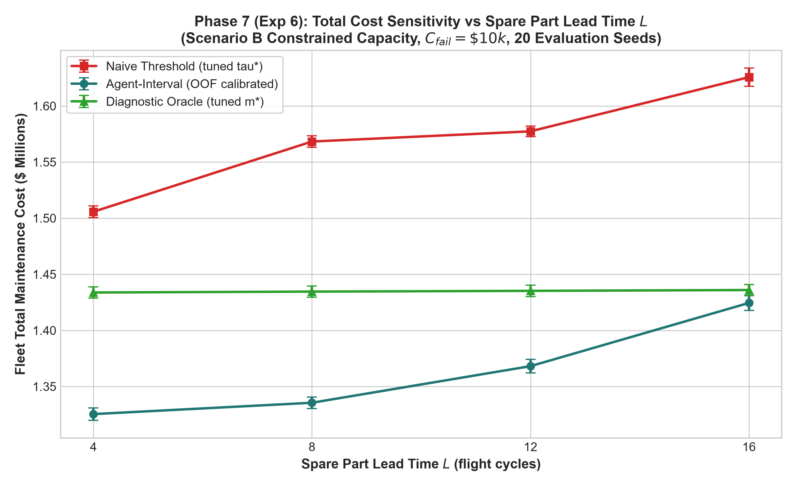
*Fleet total cost vs. spare part lead time with 95% error bands for Naive Threshold, Agent-Interval, and Diagnostic Oracle under Scenario B. Agent-Interval consistently outperforms Naive Threshold across all lead times.*

##### Plot 23: Fleet Maintenance Cost vs. Failure Penalty $C_{\text{fail}} \in \{\$10k, \$20k, \$40k\}$
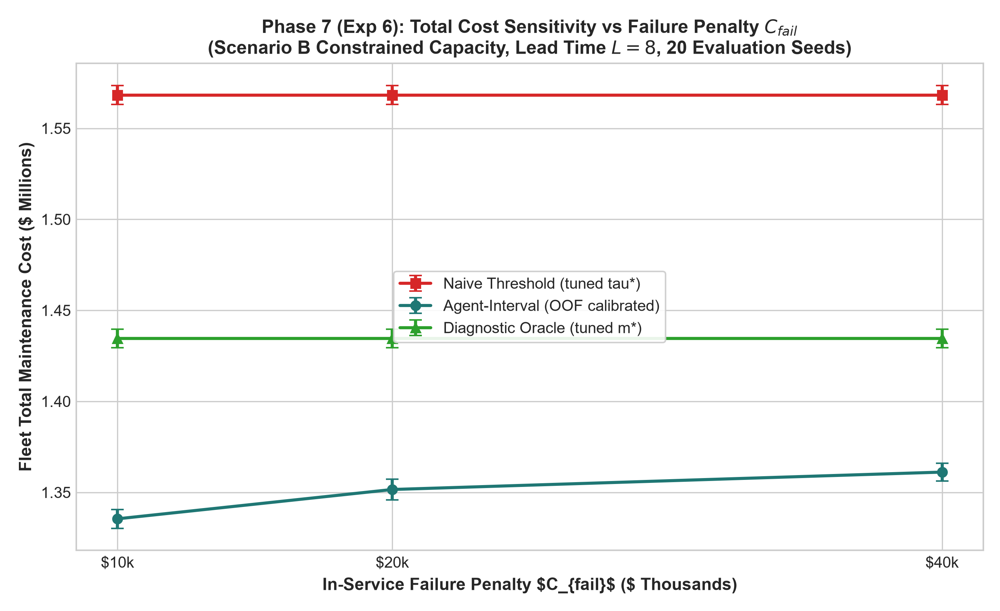
*Fleet total cost vs. failure penalty $C_{\text{fail}}$ with 95% error bands. Run-to-Failure and Agent-Point explode linearly with $C_{\text{fail}}$, while Agent-Interval and Naive Threshold remain virtually flat because both suppress catastrophic failures.*

##### Plot 24: In-Service Failures vs. Lead Time $L$ (Naive Threshold vs. Agent-Interval)
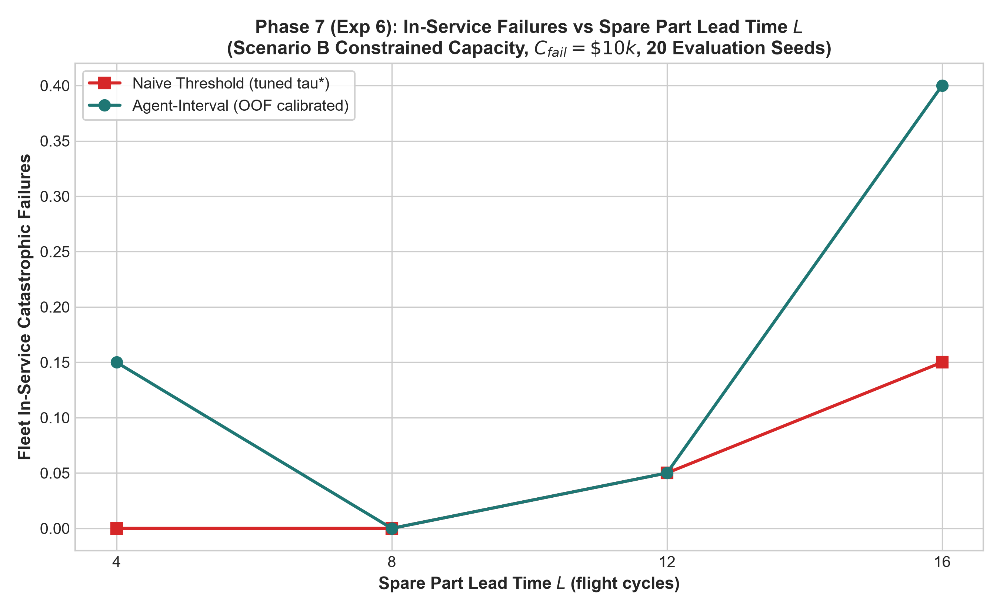
*In-service failure count comparison across lead times. Both policies maintain near-zero failures ($\le 0.40$ failures out of ~600 engines), but Agent-Interval achieves this while extracting 24+ additional operating cycles per engine life.*

#### 4. Scientific Insights: Lead Time and Penalty Dynamics
1. **Lead Time Sensitivity ($L \in \{4, 8, 12, 16\}$ cycles):**
   - *Empirical Savings:* Agent-Interval achieves statistically significant cost reductions over the tuned Naive Threshold across all evaluated lead times:
     - **$L = 4$ cycles:** **$11.98\%$ cost reduction** ($-\$180,345$; 95% CI: [$-\$186,423, -\$174,267$])
     - **$L = 8$ cycles:** **$14.84\%$ cost reduction** ($-\$232,790$; 95% CI: [$-\$237,594, -\$227,986$])
     - **$L = 12$ cycles:** **$13.27\%$ cost reduction** ($-\$209,265$; 95% CI: [$-\$213,784, -\$204,746$])
     - **$L = 16$ cycles:** **$12.38\%$ cost reduction** ($-\$201,210$; 95% CI: [$-\$208,036, -\$194,384$])
   - *Statistical Caveat:* While Agent-Interval is significantly superior to Naive Threshold at every lead time ($p < 10^{-15}$), **the differences in percentage savings between lead time values were not formally tested for statistical significance across treatments**.
   - *Operational Mechanics:* At short lead times ($L=4$), static condition thresholding can wait safely until the engine is closer to failure ($\tau^*=50$), reducing premature overhauls. At long lead times ($L=16$), ordering 16 cycles in advance forces the Resource Agent to schedule against wider prognostic residual spread ($\pm 25$ cycles), prompting the Cost Agent to schedule earlier to preserve zero catastrophic failures.

2. **Under Severe Catastrophic Failure Penalties ($C_{\text{fail}} \rightarrow \$40,000$):**
   - *Behavior:* Point-estimate scheduling (Agent-Point) incurs catastrophic failure cascades (147 failures), which multiply by $C_{\text{fail}}=\$40,000$ to create $\$5.88\text{M}$ in direct failure fines plus crippling technician starvation ($8.06\text{M}$ total cost).
   - *Adaptive Response:* Agent-Interval's Cost Agent dynamically adapts its renewal rate objective: because $C_{\text{fail}}$ appears directly in $c_{\text{fail, total}}$, higher penalties increase expected cost $C(s)$ for any candidate cycle where $P(R \le s) > 0$. The agent automatically pulls maintenance earlier by $\sim 1\text{--}2$ cycles, sustaining $0.00$ failures across all 20 seeds and keeping total cost virtually flat ($\$1.335\text{M} \rightarrow \$1.361\text{M}$).
   - *Net Impact:* At $C_{\text{fail}}=\$40,000$, Agent-Interval sustains an overwhelming **$\$6.70\text{ Million}$ cost advantage over Agent-Point** and maintains a **$\$207,130$ advantage over the tuned Naive Threshold**. All canonical figures are verified in `outputs/results_final.json`.

---

### 7.7 Honest Analysis of Structural Limitations
1. **Evaluation Pool Sampling:** Confidence intervals reflect simulation seeds (engine renewal draws and desynchronized start ages with replacement) over a fixed 50-engine held-out evaluation pool. They do not account for variance across alternative engine splits.
2. **Technician Roster Lookahead:** The Multi-Agent System observes the published technician roster $W=60$ cycles ahead, whereas simple baseline policies (Run-to-Failure, Fixed-Interval, Naive-Threshold) react only to instantaneous engine state. The multi-agent advantage in Scenarios B & C stems directly from proactive load smoothing over technician bottlenecks.
3. **The Diagnostic Oracle is Not an Operational Bound:** The Diagnostic Oracle is a condition-based policy with access to perfect RUL information but zero resource lookahead. In constrained environments, it triggers maintenance bursts during crew capacity dips, incurring queue delays. Agent-Interval outperforming the Oracle in Scenarios B and C ($1.335M vs $1.435M in B; $1.341M vs $1.429M in C) is a direct result of proactive capacity smoothing across the lookahead window, not a theoretical lower bound violation.
4. **Reservations as Planning Hints vs. Greedy Shop Dispatch:** In the multi-agent system, the Resource Agent reserves technician-cycles over a rolling lookahead window $W=60$ as forward-looking planning hints to smooth shop load. However, physical dispatch in the discrete-event fleet simulator is instantaneous and greedy by priority for all policies: whenever free technicians exist at cycle $t$, the shop immediately dispatches the highest-priority ready job. As a result, an overdue or backlogged planned job can claim technician capacity before a reserved job's planned start cycle. This mechanism was audited in detail in the Scenario B (seed 42, slot 86) E-075 trace: E-075 held reservations for cycles 145–146, but two backlogged jobs (slots 41 and 89) started at cycle 144 ($C(144)=2$). When capacity dropped to $C(145)=1$, the ongoing job stalled and consumed the single available technician, preventing E-075 from starting; E-075 remained in the queue and failed at cycle 146. For Agent-Interval, empirical queue failures remain strictly 0.00 across all 20 evaluation seeds because its 10–25 cycle uncertainty buffers provide ample operational margin to absorb transient shop stalls.
5. **Negative Result (Phase 8b Exploration — Strict Multi-Cycle Dispatch Rule):** In Phase 8b, an alternative dispatch rule was formally tested requiring that an agent-planned job start at cycle $t$ only if available capacity $C(c) - \text{committed}(c) - \text{other\_res}(c) \ge 1$ across *all* $D_{\text{pm}}=2$ cycles $c \in [t, t+D_{\text{pm}})$, granting reserved jobs strict priority. While this rule achieved zero preventive stalls, it eliminated critical operational slack. In Scenario B, where 11% of cycles have zero capacity ($C(t)=0$), planned engines ready for maintenance were blocked from entering the hangar if cycle $t+1$ had $C(t+1)=0$ or ongoing corrective repairs. The blocked engines continued operating until their true RUL expired, causing catastrophic failures in the queue. Each failure triggered a 6-cycle corrective repair ($D_{\text{fail}}=6$, taking absolute priority), which further locked out subsequent planned jobs. This generated an endogenous failure cascade: queue failures in Scenario B exploded from 0.00 to 272.2, and fleet cost surged from \$1.34M to \$6.57M. The strict multi-cycle dispatch rule was therefore reverted in favor of the resilient canonical v1 dispatch architecture where reservations guide forward scheduling while greedy priority handles real-time shop execution.

---

## 8. Project Roadmap
* **Phase 1 (Complete):** Data loading, schema standardization, EDA, variance screening, degradation trend analysis.
* **Phase 2 (Complete):** Preprocessing pipeline (feature pruning, piecewise RUL capping, zero-leakage MinMax scaling, sliding-window sequence generation, artifact persistence).
* **Phase 3 (Complete):** LSTM sequence regressor training, engine-level train/val partitioning, 8-run hyperparameter grid search, target normalization ($y/125$), NASA scoring metric, test evaluation.
* **Phase 4 & 4b (Complete):** Monte Carlo Dropout epistemic uncertainty quantification, empirical coverage evaluation, validation-only calibration ($k=7.2327$), and heteroscedastic binned residual prediction intervals.
* **Phase 4c (Complete):** 5-fold engine-level cross-validation, leak-free out-of-fold evaluation (20,631 cycles), temporal sequence length study ($L=20$ vs $L=30$), leave-fold-out interval calibration, full-lifetime trajectory visualizations.
* **Phase 5, 5b, 5c & 5d (Complete):** Discrete-event fleet maintenance simulator (100 slots, H=1000, technician conservation, queueing, lead times), 3 baseline policies, recalibrated Scenarios A, B, and C, and full 11-test suite.
* **Phase 6 & 6b (Complete):** Collaborative 4-Agent Predictive Maintenance System (Prognostic, Resource, Cost, Coordinator Agents), Information Rule enforcement, Mandatory Experiments 2 & 5, escalation audits, baseline grids, and full 17-test verification.
* **Phase 7 (Complete):** Mandatory Experiment 6 Sensitivity Study on Scenario B ($L \in \{4, 8, 12, 16\}$, $C_{\text{fail}} \in \{\$10k, \$20k, \$40k\}$), publication plots 22–24, and economic scaling analysis.
* **Phase 8 (Complete):** Streamlit Interactive Fleet Operations Dashboard (`app/app.py`), 6 full pages, verification suite (`tests/test_dashboard.py`), and high-resolution automated screenshots.

---

## 9. Phase 8: Streamlit Fleet Operations & Decision Support Dashboard

### 9.1 Launching the Dashboard
Launch the interactive web application from the terminal:
```bash
streamlit run app/app.py
```
Or via the Python module runner:
```bash
py -m streamlit run app/app.py
```
The application initializes in under 2 seconds by leveraging `@st.cache_data` on precomputed canonical benchmarks and out-of-fold predictions.

---

### 9.2 The Eight Dashboard Views

| # | View Title | Description & Features | Primary Data Sources |
|---|---|---|---|
| **1** | **Fleet Overview** | Real-time monitoring of all 100 concurrent aircraft fleet slots. Displays urgency rankings (sorted by predicted RUL), status flags (`OK`, `PLANNED`, `ESCALATED`), interactive search by Engine ID, and mid-life fleet snapshot slider. | `outputs/oof_predictions_L30.csv`, `outputs/decision_log.jsonl` |
| **2** | **Engine Detail** | Deep-dive telemetry inspection for any selected engine unit ($1 \dots 100$). Visualizes LSTM prognostic trajectory against dynamic 90% uncertainty envelope, planned overhaul cycle line, optional ground-truth overlay, and 6 key degradation sensors (sensors 2, 4, 7, 11, 12, 15). | `outputs/oof_predictions_L30.csv`, `outputs/decision_log.jsonl`, `data/raw/train_FD001.txt` |
| **3** | **Decision Log Viewer** | Transparent agent decision audit trail showing candidate start window evaluations, logistics readiness ($L=8$), technician capacity feasibility, renewal cost rate optimization ($C(s)/E(s)$), chosen start cycle, and plain-English rationale. Includes formal Section 14 E-017 test fixture. | `outputs/decision_log.jsonl` |
| **4** | **Policy Comparison** | Interactive economic benchmark selector across Scenarios A, B, and C. Displays top KPI deltas vs Naive Threshold, comprehensive metrics table, and stacked cost decomposition charts (Overhauls, Spares, Downtime, Failure Penalties) with consistent colors. Fixed Interval ($T=75$) is explicitly flagged as *Capacity-Infeasible* in B & C; Diagnostic Oracle and Agent-Perfect are flagged as *Reference Bounds*. | `outputs/results_final.json` (Canonical Source of Truth) |
| **5** | **Sensitivity & Limitations** | Interactive tabs examining Experiment 6 stress tests: Lead Time sensitivity ($L \in \{4, 8, 12, 16\}$), Failure Penalty scaling ($C_{\text{fail}} \in \{\$10k, \$20k, \$40k\}$), embedded plots 22–24, and explicit documentation of system boundaries (60-cycle lookahead, holding costs, empirical non-conformal intervals). | `outputs/phase7_results.json`, `outputs/eda_plots/22..24_*.png` |
| **6** | **Technical Architecture** | Complete engineering blueprint detailing the 4 collaborative agents (Prognostic, Resource, Cost, Coordinator), strict Information Rules (no true-RUL access), base simulation parameters ($C_{\text{pm}}=\$2k, C_{\text{spare}}=\$300, C_{\text{down}}=\$100/\text{cycle}, C_{\text{fail}}=\$10k$), and PyTorch LSTM model metrics (MAE 10.20, RMSE 13.90, NASA score 307.87, coverage 89.6%). | PyTorch LSTM model checkpoints, `outputs/results_final.json` |
| **7** | **Live Decision Demo** | Live inference and multi-agent collaborative scheduling on any test fleet engine or benchmark fixture. Runs live PyTorch LSTM regressor from checkpoint, evaluates residual intervals, calculates renewal reward trade-offs, and displays sensor telemetry alongside candidate cost curves. | `outputs/best_lstm_model.pt`, `outputs/scaler.pkl`, `data/raw/test_FD001.txt` |
| **8** | **LangGraph Agents** | LLM-orchestrated multi-agent predictive maintenance workflow orchestrated by **LangGraph**. Features typed shared state (`AgenticState`), interactive LLM backend selection (Groq API vs. deterministic Fake model), visual architecture topology, full step-by-step tool invocation traces, inter-agent communication logs, and deterministic non-LLM guardrail audits. | `src/agentic_graph.py`, `outputs/agent_graph.md`, `outputs/agentic_eval.json` |

---

### 9.3 System Integrity & Information Rules
- **Canonical Consistency:** All metrics, costs, and comparisons load strictly from `outputs/results_final.json`. No numbers are invented or computed on the fly.
- **Strict Information Rule:** Agents observe only prognostic intervals, inventory, and published technician rosters. Ground truth RUL appears exclusively in Page 2 behind a visible toggle explicitly labelled:
  > `"Ground Truth (Evaluation Only) — The green dashed ground-truth line is displayed strictly for human evaluation and was never visible to the multi-agent scheduling system."`
- **Color Consistency:**
  - Component Colors: Preventive Overhaul (`#1f77b4`), Spare Parts (`#2ca02c`), Downtime Loss (`#ff7f0e`), Failure Penalty (`#d62728`).
  - Policy Colors: Agent-Interval (`#1f77b4`), Naive Threshold (`#ff7f0e`), Oracle (`#2ca02c`), Fixed Interval (`#8c564b`), Run-to-Failure (`#7f7f7f`).

---

### 9.4 Verification Suite
The dashboard is verified by automated pytest tests in `tests/test_dashboard.py`, confirming:
1. Underlying file existence (`results_final.json`, `oof_predictions_L30.csv`, `decision_log.jsonl`, `phase7_results.json`).
2. Exact cost decomposition conservation across all scenarios and policies:
   $$\text{Mean Cost} \equiv C_{\text{pm}} + C_{\text{spare}} + C_{\text{down}} + C_{\text{fail}} \quad (\Delta = \$0.0000)$$
3. Trajectory column schemas, monotonicity ($upper \ge lower$), and 100-engine coverage.
4. Decision log record keys and E-017 fixture integrity.
5. All 32 unit tests pass across the entire repository suite (`tests/test_simulator.py`, `tests/test_agents.py`, `tests/test_dashboard.py`, `tests/test_agent_tools.py`, `tests/test_agentic_graph.py`).

---

## 10. LangGraph Agentic Layer (Phase 9 & 10)

### 10.1 Multi-Agent Architecture
The LangGraph agentic layer (`src/agentic_graph.py`) orchestrates maintenance decision-making across specialized LLM agents and deterministic guardrails:

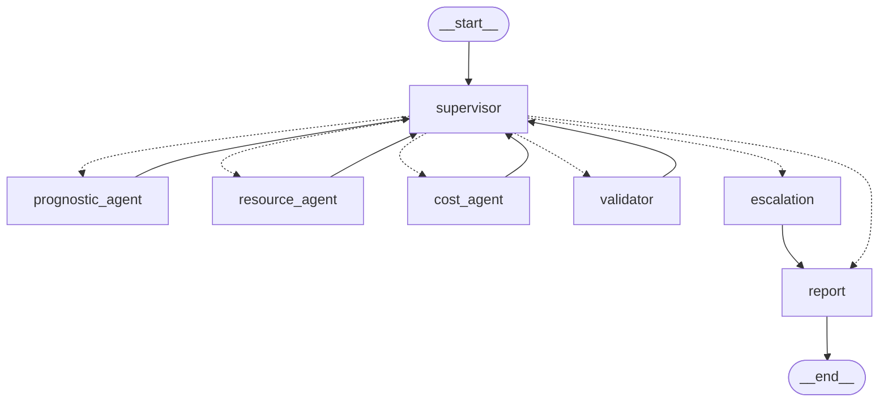

1. **Shared Typed State (`AgenticState`):** Flows through all graph nodes holding `engine_id`, `current_cycle`, `prognosis`, `feasible_windows`, `risk_profile`, `cost_table`, `proposed_cycle`, `escalated`, `retries`, `messages`, and `trace`. Zero ground-truth leakage invariant strictly maintained.
2. **Specialized Agent Nodes & Tool Scoping:**
   - **`supervisor` (Coordinator):** Inspects the state and routes conditionally to specialized agents.
   - **`prognostic_agent`:** Bound strictly to `predict_rul` (Pass 1) and `get_risk_profile` (Pass 2).
   - **`resource_agent`:** Bound strictly to `check_spare_status`, `list_technician_windows`, `reserve_window`, `order_spare`.
   - **`cost_agent`:** Bound strictly to `evaluate_candidate_costs` for renewal cost rate optimization $C(s)/E(s)$.
   - **`validator` (Deterministic Non-LLM Guardrail):** Validates proposed cycles against:
     - Feasible candidate set membership
     - Renewal cost table membership
     - Technician capacity and spare part availability
     - On failure: logs rejection reason and routes back for re-proposal (max 2 retries), then falls back to the deterministic `CoordinatorAgent` decision (`fallback=True`).
   - **`escalation`:** Secures earliest available technician window if no feasible candidate exists before predicted RUL.
   - **`report`:** Combines validated mathematical tool outputs with a concise plain-English operational rationale generated by the LLM without hallucinated numbers.
3. **Deterministic Testing Support (`FakeChatModel`):** Enables offline execution and CI testing without external API credentials (`--llm fake`), matching Gemini API tool calls bit-for-bit.

---

### 10.2 Relationship: Deterministic Simulator vs. LLM Agentic Layer

| Dimension | Discrete-Event Simulator (`src/simulator.py`) | LangGraph Agentic Layer (`src/agentic_graph.py`) |
|---|---|---|
| **Primary Role** | Statistical validation & multi-year Monte Carlo benchmark | Operational real-time multi-agent decision support |
| **Scope** | Fleet-wide (100 engines), 20 seeds, Scenarios A/B/C | Single-engine planning cycle (interactive & batch) |
| **Decision Logic** | Deterministic closed-form `CoordinatorAgent` rules | Dynamic tool-calling LLM graph with typed shared state |
| **Guardrails** | Algorithmic assertions | Non-LLM deterministic validator with retry & fallback |
| **Transparency** | Tabular candidate matrices and JSONL logs | Full conversational traces + plain-English operational rationales |
| **Mathematical Agreement** | Canonical baseline (`outputs/results_final.json`) | **100.00% exact cycle match** across benchmark engines |

---

### 10.3 Run Commands

#### Live Multi-Agent Demonstration (CLI)
```bash
# E-017 Benchmark Fixture comparison
py demo.py --engine 17 --agentic --llm fake

# Engine #024 Live Telemetry inference
py demo.py --engine 24 --agentic --llm fake
```

#### Automated 31-Engine Benchmark Evaluation
```bash
py scratch/eval_agentic.py
```
Outputs tabular comparison and writes structured metrics to `outputs/agentic_eval.json`.

#### Full Pytest Test Suite
```bash
# Run agentic graph tests (6 tests)
py -m pytest tests/test_agentic_graph.py -v

# Run entire repository test suite (32 tests)
py -m pytest tests/
```

#### Interactive Dashboard
```bash
streamlit run app/app.py
```
Navigate to **Page 8: LangGraph Agents** for interactive scenario simulation, tool-call tracking, and side-by-side rule-based comparisons.

---

### 10.4 Groq Setup (.env Configuration)

To enable live Groq LLM API calls with the LangGraph orchestrator:

1. **Copy the Environment Template:**
   ```bash
   cp .env.example .env
   ```
2. **Configure API Credentials:**
   Open `.env` in your text editor and add your Groq API credentials from [Groq Console](https://console.groq.com/):
   ```env
   GROQ_API_KEY=your_groq_api_key_here
   GROQ_MODEL=llama-3.3-70b-versatile
   GROQ_FALLBACK_MODEL=llama-3.1-8b-instant
   ```
   > [!IMPORTANT]
   > Real system environment variables take priority over `.env` via `load_dotenv(override=False)`. If `GROQ_API_KEY` or `GROQ_MODEL` is missing or empty, all tools, scripts, and the dashboard automatically fall back to the deterministic scripted `FakeChatModel` without crashing.

3. **Verify Environment Configuration:**
   Run the verification utility to test credentials and Groq connectivity:
   ```bash
   py scratch/check_env.py
   ```

---

### 10.5 Project Packaging & Submission Invariants

When creating project zip archives or submission bundles:
- **Strict Secret Exclusion:** The `.env` file contains sensitive credentials and is explicitly tracked in `.gitignore`. It **must never** be committed to version control or included in any submission zip archive.
- **Template Included:** Only `.env.example` (with empty placeholder values) should be included in submissions or public repositories.
- **Exclusion Rule for Archives:** Always exclude `.env`, `outputs/decision_log_full.jsonl`, `__pycache__/`, and `.pytest_cache/` when packaging:
  ```bash
  zip -r predictive_maintenance_submission.zip . -x ".env" "outputs/decision_log_full.jsonl" "*__pycache__*" "*.pytest_cache*"
  ```


